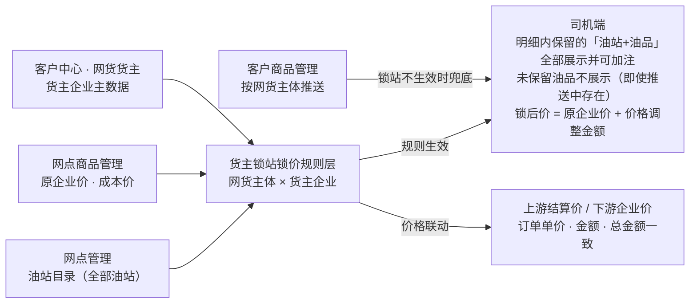

架构说明：本模块新建的主数据只有规则本身。网货主体取自现网客户企业主数据（搜索下拉引用）；货主企业取自「客户中心 → 网货货主」维护的主数据；油站目录取自网点管理全部油站；原企业价、成本价在「网点商品管理」维护（与客户商品管理的按主体推送相互独立）。规则层输出「可见油站集合＋锁后价」：规则生效期间明细内保留的「油站+油品」全部可见可加注（规则涉及的油站未保留的油品不展示，即使推送中存在；规则未涉及的推送油站照常展示），锁站不生效时回落客户商品管理按网货主体的推送数据；锁后价同时驱动上游结算价与下游企业价的同步变更。
