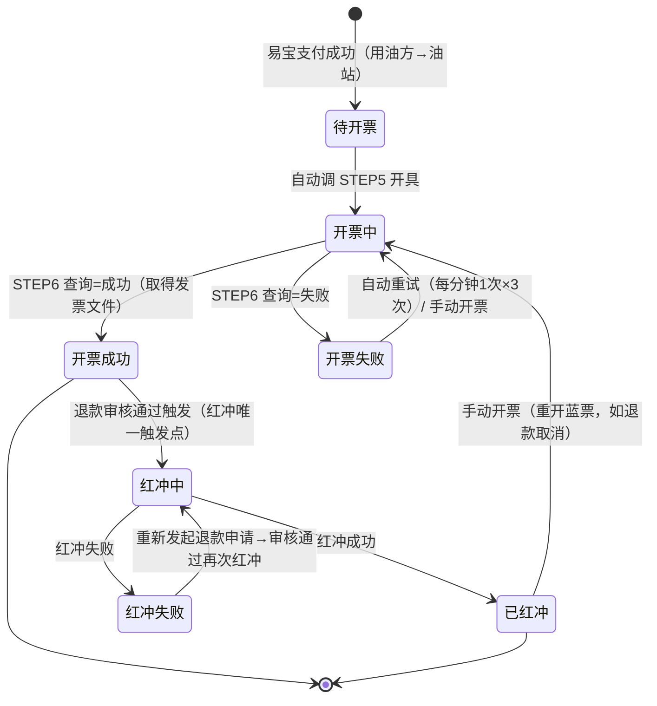
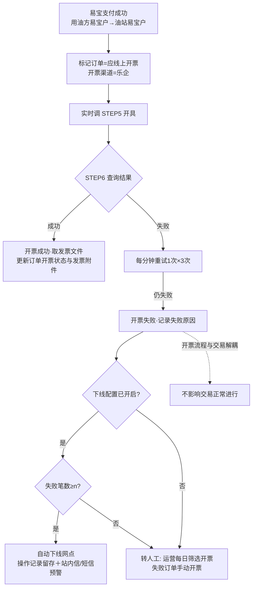
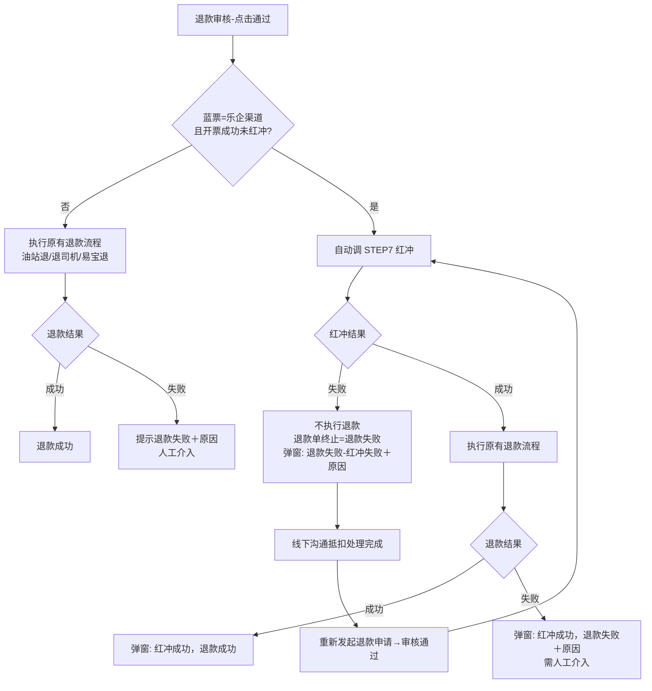

# 【万油通】易宝支付订单接乐企开票 · 需求规划

> 状态：待用户确认（确认后作为原型修改与 PRD 撰写的唯一依据）
> 依据：MRD《【万油通】易宝支付订单接乐企开票》（飞书 U4EOd0148oUdecxth69cu1FvnQb，rev 2557）+ 2026-10-19 用户澄清
> 本文档只做规划：不改原型、不写 PRD。

---

## 0. 结论速览

**做什么**：凡走**易宝支付**结算、**直接与加油站结算**的**柴油**能源订单（撮合易宝模式＋自营模式），支付成功后系统实时调用乐企自动开票，交易与开票解耦；订单列表呈现开票状态/渠道/失败原因/发票附件并支持手动开票；所有退款在审核通过后**先红冲后退款**，红冲失败拦截退款（红冲均由退款发起）；网点公司管理页提供「开票失败 n 笔自动下线」熔断配置；发票中心新增**「订单发票管理」菜单**（撮合＋自营的乐企发票全量历史）。

**不做什么**：
- 天然气订单——**本期不自动开票**（不接乐企，按线下渠道口径处理与展示）。先做柴油是因国家政策当前只要求柴油；口径设计不排斥天然气，后续政策要求时纳入自动开票（用户澄清）；
- 三方对接站订单、非易宝支付订单——不接乐企（维持线下开票现状）；
- 手动红冲——**红冲均由退款发起**，不提供手动红冲入口（用户裁定；MRD 需求描述 3 第 9 条本期不实施）；
- 上线前已走易宝支付的历史订单——乐企不支持处理，维持原状（状态/渠道如需更新由技术配合，MRD 数据需求已定）；
- 油站企业开通/激活/授权（流程 1）——用易宝现有能力，不做接口对接；
- 企业端、油站端页面——本期不动（建议口径，见 §3.3）；
- 服务费订单开票——不在本期范围（本期仅能源订单）。

**已确认的关键裁定**（2026-10-19，三轮澄清）：状态按渠道分治；红冲仅拦乐企蓝票且红冲均由退款发起；退款均为整单；下线计数为快照＋恢复清零；红冲失败后退款单终止、重新发起；自营页面覆盖=订单管理＋订单退款；不存在「无需开票」枚举值；开票渠道枚举=乐企、线下；发票中心新增「订单发票管理」菜单；天然气本期不自动开票（不排斥、后续纳入）。

**后续动作**：规划确认 → 原型改造（4 新增＋2 增量）→ 逐页 PRD → 全项目通读 → PROJECT.md 沉淀。

---

## 1. 需求理解与范围

### 1.1 背景

《国家税务总局关于在成品油零售领域全面推广"交易即开票"有关事项的公告》（2026 年第 11 号）：2026-11-01 起全国成品油零售加油站全面推行"交易即开票"。原则：**既要保证笔笔开票及时性，又不能影响业务**。

### 1.2 应开票范围（本期乐企口径）

一笔能源订单同时满足以下三个条件才走乐企自动开票：

| 条件 | 口径 |
|---|---|
| 油品 | 仅柴油（0#/-10#/-20#/-35# 等柴机油品）。先做柴油是因国家政策当前只要求柴油；**天然气本期不自动开票**（不接乐企，按线下渠道口径处理与展示），口径设计不排斥天然气、后续政策要求时纳入 |
| 支付 | 走易宝支付结算（撮合易宝模式 924 已上线；自营模式 d0d1 开发中，结算路径=用油方易宝户→油站易宝户） |
| 结算对象 | 直接与加油站结算（不包括三方对接站） |

自营模式的用油方：可以是网货主体，也可以是自签物流公司（MRD 注）。

不满足范围 → 不接乐企：线下开票场景（现有"客户申请＋油站上传"流程），由**开票渠道=线下**区分展示（见 §2.1 裁定⑥）。

### 1.3 开票主体取值（票面）

| 角色 | 取值来源 |
|---|---|
| 销方（油站企业） | 网点公司-认证信息 的税号和名称 |
| 购方（用油方=物流公司） | 客户公司-认证信息 的税号和名称 |
| 购方（用油方=万油通主体） | 内部公司 的税号和名称 |

票面无需带折扣行；能源订单维度笔笔开票（一单一张，不合并）。

---

## 2. 已确认口径（决策记录）

| # | 裁定 | 内容 | 来源 |
|---|---|---|---|
| ① | 开票状态**按渠道分治** | 开票渠道=乐企的订单用 7 值状态集：`待开票/开票中/开票失败/开票成功/红冲中/红冲失败/已红冲`；开票渠道=线下的订单沿用既有 4 值：`未开票/开票中/已开票/已撤销`。同一列按订单渠道显示对应值集 | 2026-10-19 用户选择 |
| ② | 红冲前置**仅拦乐企蓝票** | 仅当蓝票为易宝-乐企渠道开出、且开票成功未红冲时，退款审核通过才前置红冲；线下渠道发票退款不拦截，维持现状 | 2026-10-19 用户选择（与 MRD 流程 3 一致） |
| ③ | 退款均为**整单退款** | 不存在按金额部分退款；自营的「客户退款/油站退款」是同一次退款的资金两侧；发票按订单维度整票红冲一次 | 2026-10-19 用户选择 |
| ④ | 下线计数＝**快照＋恢复清零** | 计数=该站**当前**「开票状态=开票失败」的应开票订单数（历史全量、不限时间窗；做过红冲即状态为红冲中/红冲失败/已红冲的不算，快照口径天然满足）；达标→自动下线；运营重新启用恢复，恢复后计数从 0 重新累计 | 2026-10-19 用户选择 |
| ⑤ | 红冲失败闭环＝**退款单终止，重新发起** | 审核确认后红冲失败：不执行退款、退款单终止为「退款失败」，弹窗提示「退款失败-红冲失败＋原因」；线下抵扣处理完成后，订单重新发起红冲，红冲成功后**重新发起退款申请**再走审核 | 2026-10-19 用户选择 |
| ⑥ | **不存在「无需开票」枚举值** | MRD 所称【无需开票】＝不通过乐企开票、线下开票的场景，由「开票渠道」字段区分，不新增状态值 | 2026-10-19 用户澄清 |
| ⑦ | 自营页面覆盖＝**订单管理＋订单退款**两页 | 按用户提供的现网 URL（oms.wanyoutong.cn#/orderInfo/orderInfo、#/orderInfo/orderRefund）；「网货订单管理」等其它订单入口本期不动，后续另提 | 2026-10-19 用户选择 |
| ⑧ | 原型落地＝**规划确认后新增 4 页** | 新增自营订单管理、自营订单退款、网点公司管理（自动下线配置）、订单发票管理（发票中心新菜单）简化演示页；撮合 orders/refund 两页增量改造 | 2026-10-19 用户选择（首轮 3 页，二轮新增订单发票管理） |
| ⑨ | 开票渠道枚举＝**乐企、线下** | 枚举穷举 2 值：`乐企`、`线下`（不叫「易宝乐企」） | 2026-10-19 二次澄清 |
| ⑩ | **红冲均由退款发起**，本期不做手动红冲 | 红冲唯一触发点=退款审核通过时系统自动调用；不提供手动红冲入口。红冲失败后的重试路径＝线下抵扣处理完成 → 重新发起退款申请 → 审核通过再次触发红冲（取代 MRD「订单再次发起【红冲】操作」的手动落法） | 2026-10-19 二次澄清 |
| ⑪ | 发票中心新增**「订单发票管理」菜单** | 包含撮合订单的乐企发票、自营订单的乐企发票；展示**所有历史**的发票数据，含开票、红冲、再次开票（蓝票/红票逐张可见） | 2026-10-19 二次澄清 |
| ⑫ | 自动下线配置放**网点公司管理页** | 用户给定现网 URL：oms.wanyoutong.cn#/siteCenter/oilSiteCompanyInfo（MRD 正文写「网点管理」、截图同为网点管理页，按用户给定 URL 收敛到网点公司管理页） | 2026-10-19 用户给定 |
| ⑬ | **天然气本期不自动开票** | 天然气订单不接乐企（不自动开票、不可乐企手动开票），按线下渠道口径处理与展示；口径设计不排斥天然气，后续政策要求时纳入自动开票 | 2026-10-19 三轮澄清（取代「本期不支持」的表述） |

---

## 3. 建议口径（低风险项，随本文档整体确认）

| # | 项 | 建议口径 | 依据 |
|---|---|---|---|
| 3.1 | 开票失败自动重试 | 写死 MRD 流程口径：开票失败后**每分钟重试 1 次、共 3 次**（走乐企重试开具能力），仍失败停留在`开票失败`转人工；不做成可配置项 | MRD 流程 2 画板 |
| 3.2 | 撮合易宝订单开票资格 | 易宝支付成功即触发乐企开票，**不再校验「分账处理完成」**（易宝转账完成＝资金已到油站）；「分账处理完成」前置仅保留给线下渠道的既有申请流程；乐企订单不进入「批量申请开票」勾选池 | MRD 触发节点；原型 L826 现状冲突 |
| 3.3 | 端与权限 | 手动开票/批量下载/下线配置均为**运营端（PC）**能力，沿用运营平台现有权限体系（具体权限点由技术侧定义）；企业端、油站端本期不动 | MRD 均为 PC 页面需求；裁定⑩ |
| 3.4 | 发票附件展示 | 订单列表行：仅「开票成功/已红冲」最新 1 张发票附件入口（支持查看/下载，不限格式 url/pdf/ofd）；订单详情：该订单关联**全部**蓝红票列表＋逐张下载；批量下载：仅`开票成功/已红冲`订单可勾选、仅下载最新 1 次发票、支持单选/多选格式、权限控制；「能源发票管理」页本期不改造，乐企发票归「订单发票管理」（裁定⑪） | MRD 需求描述 3 |
| 3.5 | 开票状态筛选与渠道联动 | 「开票渠道」单选（`乐企`/`线下`，默认全部）；「开票状态」多选，选项按渠道分组展示（乐企组 7 项／线下组 4 项）；未选渠道时显示全部分组，匹配=订单渠道与状态同时命中 | 裁定①⑨的筛选落法 |
| 3.6 | 红冲互斥边界 | 同一订单同一时刻至多一个红冲在途：`红冲中`状态时退款审核不可通过（提示「红冲进行中」），也不存在第二个红冲触发点（裁定⑩后天然单触发源，保留并发保护） | 并发保护，MRD 未覆盖 |
| 3.7 | 开票记录留存 | 数据库记录每次开票（蓝票＋红票）的请求与结果；原型在订单详情与「订单发票管理」以记录/发票明细体现（时间/触发方式 自动-支付成功\|退款红冲\|手动开票/动作/结果/失败原因） | MRD 需求描述 5 |
| 3.8 | 自动下线的动作对象 | 下线＝该网点公司**启用状态置为停用**（该网点公司不可再产生新订单）；字段落点（启用状态 vs 网点/油站上架状态）由技术方案阶段确认，规划层按「网点公司停用」表达 | 用户给定配置页面（裁定⑫）；MRD"自动下线油站（公司）" |
| 3.9 | 本规划文档落点 | `docs/requirements/20261019-易宝乐企开票-规划.md`（本文件） | skill 约定 |

---

## 4. 开票状态机与乐企接口映射

### 4.1 乐企渠道状态机（7 值）

状态语义（MRD 举例）：列表展示**最新 1 次开票（蓝票＋红票）**的状态——
- 已拿到 1 张蓝票＋触发了红冲 = `红冲中`；拿到红冲结果 = `已红冲/红冲失败`
- 蓝票＋红票＋触发了开票 = `开票中`；拿到结果 = `开票成功/开票失败`
- 蓝＋红＋蓝＋触发红冲 = `红冲中`，以此循环

### 4.2 线下渠道状态机（4 值，不变）

`未开票 → 开票中 → 已开票 / 已撤销`（现有"客户申请＋油站上传"流程，保持不变）。

### 4.3 乐企接口 ↔ 动作映射

| 乐企接口 | 触发时机 | 状态流转 |
|---|---|---|
| STEP5 发票开具 | 易宝支付成功（自动）；手动开票（待开票/开票失败/已红冲） | →`开票中` |
| STEP6 开具结果查询 | `开票中`轮询 | →`开票成功`（取发票文件）／`开票失败` |
| STEP8 发票重试开具 | 开票失败自动重试（每分钟 1 次×3 次）；手动开票 | 停留`开票失败`直至成功 |
| STEP7 发票冲红 | 退款审核通过（系统自动，唯一触发点，裁定⑩） | →`红冲中`→`已红冲/红冲失败` |
| STEP9 发票文件重新发送 | 开具成功但发票文件获取失败 | 状态不变（`开票成功`），补拉发票附件 |

手动开票可用状态：`待开票`、`开票失败`、`已红冲`（且本期应开票范围内）（MRD 需求描述 3 第 8 条）；手动红冲本期不实施（裁定⑩）。

---

## 5. 业务流程

### 5.1 支付即开票（流程 2）

要点：开票失败不影响交易（订单照常完成）；转人工=运营在订单列表筛选`开票失败`手动开票，仍失败找技术排查（MRD 流程 2）。

### 5.2 退款-红冲（流程 3，撮合 refund 页＋自营 orderRefund 页同规则）

要点：
- 所有退款入口都走【退款审核】（MRD 注；撮合与自营均成立）；
- **红冲均由退款发起**（裁定⑩）：无手动红冲入口，STEP7 仅在退款审核通过时由系统调用；
- 红冲失败被拦的退款单**终止**，不挂起（裁定⑤）；线下抵扣处理完成后，重新发起退款申请、审核通过时再次触发红冲；
- 「客户退款/油站退款」两条记录为同一次退款的资金两侧，发票红冲按订单维度一次（裁定③）。

### 5.3 失败熔断-自动下线（需求描述 1）

| 环节 | 口径 |
|---|---|
| 配置入口 | **网点公司管理页**（现网 siteCenter/oilSiteCompanyInfo，裁定⑫），按网点公司配置「线上开票失败 n 笔自动下线」 |
| 开关 | 可开启/关闭，**默认关闭**；开启时校验该网点公司**已开通易宝账户**，否则不允许配置 |
| 阈值 n | 开启时默认 **1**，可修改（正整数） |
| 计数 | 该站**历史所有**应开未开订单数量（非从开启时间起算）；未开=当前`开票状态=开票失败`；做过红冲（红冲中/红冲失败/已红冲）一律不算"未开"（快照口径自动满足，裁定④） |
| 触发 | 开票失败落定时统计，计数 ≥ n → 自动下线（网点公司启用状态置为停用，建议口径 3.8；不可再产生新订单） |
| 留痕 | 网点公司详情-操作记录留存 1 条自动下线记录（原因：线上开票失败累计 n 笔） |
| 预警 | 站内信预警＋短信预警（用现有能力） |
| 恢复 | 运营在网点公司管理重新启用；恢复后计数从 0 重新累计（裁定④） |

---

## 6. 页面改动清单（原型层面，规划粒度）

> 共享组件（dataTable/filterRow/pagerHTML/notes/openConfirm/showDrawer/MODALS）预期零签名改动；新增列/筛选项/按钮均落在页面实现段。

### A. 撮合·能源订单管理（`#orders`，增量修改）

| 改动点 | 内容 |
|---|---|
| 新增列 | 开票渠道（乐企/线下，裁定⑨）；开票状态列改为按渠道分治显示（乐企 7 值/线下 4 值，裁定①）；失败原因（`开票失败/红冲失败`时展示，单元格内或悬浮） |
| 新增筛选 | 开票渠道（单选）；开票状态（多选、按渠道分组，§3.5） |
| 新增行操作 | 手动开票（`待开票/开票失败/已红冲`且应开票范围内可点，否则隐藏；乐企渠道订单）。红冲无手动入口（裁定⑩） |
| 新增批量动作 | 批量下载发票（勾选行，仅`开票成功/已红冲`可选、其余置灰不可选；单选/多选格式；权限控制；仅下载最新 1 次发票） |
| 详情抽屉 | 新增开票信息区：最新 1 张发票附件（查看/下载）＋全部蓝红票列表（逐张下载）＋开票记录列表（§3.7） |
| 既有行为 | 「批量申请开票」保留给线下渠道订单；乐企订单不进勾选池（§3.2）；页面说明同步改写（含废止"开票后退款不联动发票状态"旧口径） |
| 演示数据 | 补易宝支付柴油订单，覆盖开票成功/开票失败/红冲中/已红冲/红冲失败等状态；字段载体（支付方式展示）原型阶段最小化处理 |

### B. 撮合·退款申请管理（`#refund`，增量修改）

| 改动点 | 内容 |
|---|---|
| 审核确认动作 | 「确认退款」增加红冲前置分支（§5.2）：需要红冲→先红冲→按结果走三态提示（红冲成功＋退款成功／红冲成功＋退款失败需人工／退款失败-红冲失败＋原因） |
| 状态枚举 | 退款状态新增终态「退款失败」（红冲失败被拦时落入；重新发起退款申请新开一单） |
| 详情抽屉 | 进度线补充红冲节点（触发时间/结果/失败原因）；被拦单展示「线下抵扣处理完成→重新发起退款申请→审核通过再次触发红冲」的后续路径说明（裁定⑩） |
| 演示数据 | 补：需红冲且红冲成功的单、红冲失败被拦的单 |

### C. 自营·订单管理（新增原型页，对应现网 orderInfo/orderInfo）

| 改动点 | 内容 |
|---|---|
| 页面结构 | 简化复刻现网：筛选（订单流水号/交易司机/所属公司/油站名称/能源类型/支付状态/扣款状态/订单时间等核心项）＋按钮（搜索/重置/订单补录/导出）＋列（公司信息/客户信息/油站信息/司机支付状态/油站扣款状态/订单核销状态/开票渠道/开票状态/失败原因/订单流水号/操作） |
| 行操作 | 详情/操作下拉（整体退款/客户退款/油站退款/网点支付/修改结算信息——现状保留）＋手动开票（按状态亮灭，同 A；红冲无手动入口） |
| 详情抽屉 | 开票信息区（同 A） |
| 演示数据 | 柴油＋易宝支付订单为主（覆盖各开票状态），天然气订单表达本期不自动开票（线下渠道口径展示，裁定⑬） |

### D. 自营·订单退款（新增原型页，对应现网 orderInfo/orderRefund）

| 改动点 | 内容 |
|---|---|
| 页面结构 | 筛选（订单流水号/退款类型/油站名称/日期范围）＋按钮（搜索/重置/导出）＋列（订单流水号/退款类型 客户退款|油站退款/订单信息/退款金额/审核状态 待审核|审核通过|退款失败/操作） |
| 审核弹窗 | 子订单明细（子订单流水号/运单号/司机/车牌号/实付金额）＋审核通过/审核驳回；通过时红冲前置分支＋三态提示（同 B） |
| 演示数据 | 待审核（需红冲/无需红冲）、审核通过、红冲失败被拦等案例 |

### E. 网点公司管理（新增原型页，对应现网 siteCenter/oilSiteCompanyInfo，裁定⑫）

| 改动点 | 内容 |
|---|---|
| 页面结构 | 简化复刻现网：筛选（客户名称/客户等级/运营负责人/业务负责人/商务负责人）＋按钮（搜索/重置/新增/导出）＋列（客户名称+ID/客户等级/启用状态/业务负责人/运营负责人/商务负责人/创建信息/操作） |
| 现有行操作 | 修改/复制录入/详情/开通账户/撮合开户（现状保留） |
| 新增配置入口 | 行操作新增「开票配置」（或入详情内，原型阶段定）：弹窗含开关（默认关）＋阈值 n（默认 1）；开启时校验该网点公司已开通易宝账户（行上「易宝账户」状态列/标记），未开通拦截并提示 |
| 详情/操作记录 | 操作记录列表含「自动下线」记录（触发时间/原因：线上开票失败累计 n 笔）；「启用」动作（恢复，计数清零） |
| 演示数据 | 已开启配置站/未开启站/未开通易宝账户站/触发过自动下线的站 |

### F. 发票中心·订单发票管理（新增原型页＋现网新菜单，裁定⑪）

| 改动点 | 内容 |
|---|---|
| 菜单归属 | 发票中心新增「订单发票管理」菜单（现网发票中心/开票中心两级菜单均存在，最终归属按现网实际层级落位，原型阶段定） |
| 数据范围 | **撮合订单的乐企发票＋自营订单的乐企发票**；展示所有历史的发票数据——每张发票一行（蓝票/红票逐张可见），含开票、红冲、再次开票产生的全部票 |
| 列 | 发票号码/发票类型（蓝票/红票）/订单流水号/业务线（撮合/自营）/销方（油站企业）/购方（物流公司或万油通主体）/金额/开票时间/触发方式（自动-支付成功/退款红冲/手动开票）/关联发票（红票关联原蓝票；重开蓝票关联原红票）/开票结果状态（开票成功/已红冲）/附件（查看/下载） |
| 筛选 | 订单流水号/发票号码/业务线/发票类型（蓝票/红票）/开票时间范围（建议项，原型阶段定稿） |
| 操作 | 单张发票查看/下载附件；导出（建议项） |
| 演示数据 | 撮合＋自营各若干：单蓝票/蓝票+红票/蓝+红+再次开蓝的多轮循环案例 |

### G. 不动的页面

企业端（cOrders/cRefund/cApply）、油站端、服务费订单（fee）、能源发票管理（energyInvApply）、发票中心其余页面——本期不改（建议口径 §3.3/§3.4）。

---

## 7. 与既有能力的冲突与衔接

| 既有口径 | 本次处理 |
|---|---|
| 撮合订单开票状态 4 值（`未开票/开票中/已开票/已撤销`，index.html L1617） | 保留给线下渠道订单；乐企渠道订单用 7 值集，同列分治展示（裁定①） |
| orders 页页面说明"开票后退款：本期不联动发票状态，已开票状态和流程保持不变"（L2527） | **废止**：乐企渠道订单退款前置红冲、红冲失败拦截退款（本需求核心） |
| 可开票资格要求「分账处理完成」（L826 `isEnergyInvoiceEligible`） | 易宝订单支付成功即开票、不再看分账状态；该前置仅保留给线下申请流程（§3.2） |
| 「批量申请开票→油站上传」既有流程 | 保留给线下渠道；乐企订单自动开票、不进申请池 |
| 退款状态 3 值（`待审核/审核中/已退款`，L1625） | 新增终态「退款失败」（红冲被拦） |
| 发票中心现状（能源发票管理=油站上传数电票等） | 新增「订单发票管理」菜单承载乐企发票（裁定⑪）；能源发票管理不动 |
| MRD 数据需求：上线前已走易宝订单乐企不支持 | 维持原状；状态/渠道更新需技术配合；11-01 前上游仍可开数电票，需与站端沟通提前开出 |
| MRD「订单再次发起【红冲】」手动落法 | 按裁定⑩调整：红冲均由退款发起，重试路径=重新发起退款申请→审核通过再次触发 |

---

## 8. 验收标准（规划级）

1. 易宝支付成功的柴油直连站订单，支付成功即自动发起乐企开票；开票失败不影响订单交易完成（解耦）；天然气订单不触发乐企自动开票、不可乐企手动开票（裁定⑬）。
2. 订单列表（撮合＋自营）：可按开票渠道（乐企/线下）筛选；乐企订单显示 7 值状态、线下订单显示 4 值状态；`开票失败/红冲失败`可见失败原因。
3. 手动开票按钮按状态亮灭正确（§4.3 口径），防重复提交（`开票中/红冲中`不可再触发）；无手动红冲入口，红冲仅由退款审核通过触发（裁定⑩）。
4. 退款审核通过触发红冲前置：红冲失败→不退款、退款单终止为「退款失败」、弹窗明确提示；红冲成功→退款继续执行；全程弹窗文案区分红冲与退款两侧结果。
5. 下线配置（网点公司管理页）：默认关；开启校验易宝账户；失败笔数（快照口径）达标自动下线＋操作记录留痕＋站内信/短信预警；重新启用后计数清零。
6. 发票附件：列表行最新 1 张可查看/下载；详情全部蓝红票可下载；批量下载仅限`开票成功/已红冲`且有权限控制。
7. 每次开票（蓝/红、手动/自动）记录及结果可查（详情开票记录）。
8. 订单发票管理：撮合＋自营的乐企发票全量历史可查——蓝票、红票、再次开票逐张可见，关联关系清晰，附件可查看/下载，可按业务线/发票类型筛选。

---

## 9. 依赖与风险（MRD 待办收录）

| 项 | 说明 |
|---|---|
| 乐企能力开通时效 | 等待易宝运营线下邀请企业使用乐企能力；工作日每天早、下午各一批，着急可群里联系（MRD 待办） |
| 一站多易宝账户 | 1 个油站公司 2 个易宝账户：激活需多次（每次点【开通服务】），授权只需 1 次（MRD 待办） |
| 政策时限 | 2026-11-01 前必须完成系统改造对接；11-01 前上游仍可开数电票，需及时与站端沟通开出存量票 |
| 自动下线误伤 | 快照口径下重试成功可使计数回落，但下线动作一旦触发需人工恢复——n 值默认 1 的灵敏度由业务承担（已确认） |
| 红冲-退款时延 | 红冲为同步前置（审核通过时调用并等待结果），乐企接口耗时直接影响审核操作体感；超时按红冲失败处理还是等待，技术方案阶段定 |

---

## 10. 后续动作

1. 本规划经用户确认（含 §3 建议口径逐条过目）；
2. 原型改造：撮合 A/B 增量＋自营 C/D、网点公司管理 E、订单发票管理 F 新增（每页带与 PRD 同源的页面说明折叠条）；
3. 逐页 PRD（prd-authoring 技能，飞书落库前 dry-run）；
4. 全项目通读（跨页状态流转/枚举/术语一致性）；
5. PROJECT.md 追加需求档案＋全局口径速查。
