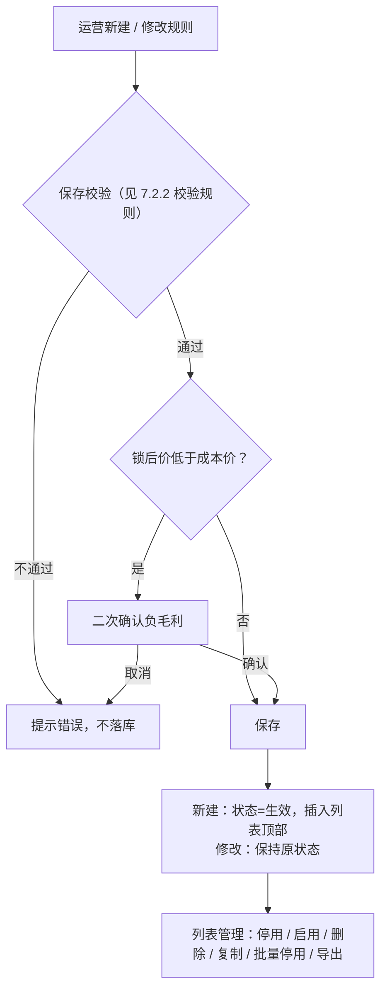
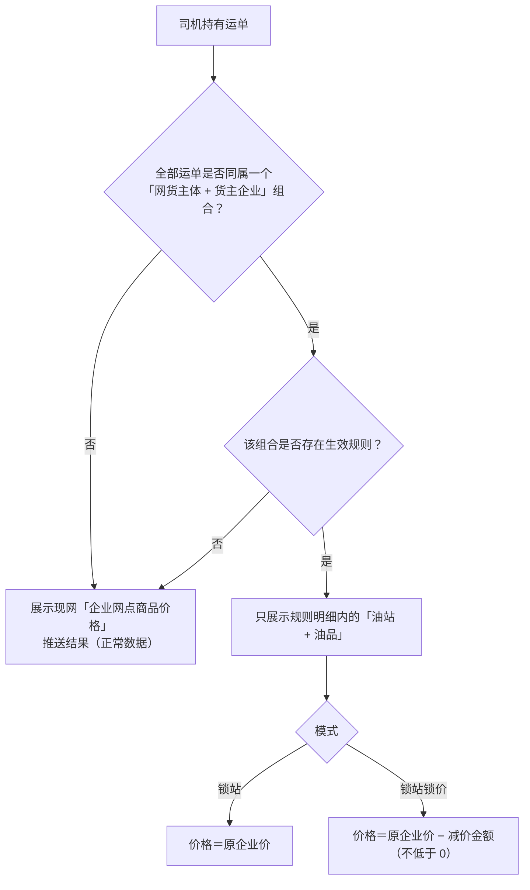

# 货主锁站锁价 · 产品需求

> 本文件为 PRD 本地定稿，与飞书文档《货主锁站锁价》正文同源；写入飞书时去掉本行以上的标题与引语。

## 5. 需求概述

本模块供运营平台配置：在现网「企业网点商品价格」推送结果之上，按「网货主体 × 货主企业」维度收敛司机端可见的油站与价格。两种模式：**锁站**（只收敛可见范围，价格沿用原企业价）与**锁站锁价**（收敛可见范围并按「油站+油品」逐行减价）。本层只做收敛不做放宽：现网未推送的油站，本模块无法使其可见。

术语（全篇统一）：**网货主体**＝现网客户企业（系统主数据）；**货主企业**＝挂在网货主体下、由运营以「名称+企业ID」清单录入的货主（无主数据匹配，以导入为准）；**原企业价**＝现网「企业网点商品价格」已推送的价格；**减价金额**＝在原企业价基础上减多少钱（元）；**锁后价**＝原企业价 − 减价金额。

### 5.1 需求范围

- 覆盖端与页面：运营平台「货主锁站锁价」页（`#freightLock`），含列表页与同页三个浮层视图：新建/修改货主锁站规则抽屉、锁站规则详情抽屉、选择油站弹层。
- 司机端不在本模块页面范围内，仅承载生效口径（见 6.2 产品流程）。
- 明确不做：「只改价、不缩范围」的独立模式（由锁站锁价模式对保持可见的站填减价金额 0 实现）；现网「企业网点商品价格」未推送油站的放开。

## 6. 需求详述

### 6.1 应用架构

架构图：

架构说明：本模块不新建主数据——网货主体取自现网客户企业主数据（搜索下拉引用）；油站、油品、原企业价、成本价取自现网「企业网点商品价格」已推送结果（只读引用）；货主企业由运营导入「名称+企业ID」，无主数据匹配。规则层输出「可见油站集合＋锁后价」，叠加在现网推送结果之上做收敛。

### 6.2 产品流程

产品流程图（配置侧）：

产品流程图（司机端判定）：

流程说明：

1. 判定前提是**组合一致性**：先判断司机的全部运单是否同属一个「网货主体+货主企业」组合——只要存在不同组合的运单，就不应用锁站锁价，直接展示现网「企业网点商品价格」推送结果（正常数据）；全部运单同属一个组合时，再判断该组合是否存在生效规则（「货主锁站锁价」模块的生效规则，锁站/锁站锁价任一模式），有则只展示规则明细内的「油站+油品」并按模式取价，没有则展示现网推送结果。
2. 未命中回落现网推送（可见性与价格均回落）；停用/删除规则后，下次查询即回落，已产生订单不追溯。
3. 货主企业清单为空（未导入）＝该网货主体下全部货主企业，后续新增货主自动适用；清单内没有「生效/未生效」状态，导入即生效、每一行都进入适用范围，不需要的删除。
4. 只做收敛不做放宽；锁后价不低于 0，低于成本价走负毛利二次确认（与现网「允许负毛利推送」口径一致）。

## 7. 功能详情

### 7.1 功能清单

运营平台：

| 一级模块 | 二级模块 | 功能点 | 类型 | 说明 |
|---|---|---|---|---|
| 商品中心 | 货主锁站锁价 | 规则列表与筛选 | 新增 | 8 列列表、6 项筛选、重置/搜索、分页 20/50/100、列设置 |
| 商品中心 | 货主锁站锁价 | 新建/修改规则抽屉 | 新增 | 基本信息、适用范围、油站明细三段；保存校验 17 项 |
| 商品中心 | 货主锁站锁价 | 货主企业清单录入 | 新增 | 粘贴/Excel 双入口，去重、导入即生效（无状态勾选）、清单为空＝全部货主语义 |
| 商品中心 | 货主锁站锁价 | 油站选择器 | 新增 | 搜索/能源筛选/只看已选/分页，按油站勾选、勾选即带出该站全部油品行 |
| 商品中心 | 货主锁站锁价 | 规则详情 | 新增 | 页头指标、基本信息、适用范围、明细全量表 |
| 商品中心 | 货主锁站锁价 | 规则操作 | 新增 | 详情/修改/停用/启用（含冲突拦截）/删除/批量停用/复制/导出 |
| 商品中心 | 货主锁站锁价 | 司机端生效口径 | 新增 | 组合一致性判定（全部运单同属一个「货主+网货主体」才应用）、锁站/锁站锁价取价、未命中回落（页外口径，见 6.2） |

### 7.2 功能说明

#### 7.2.1 货主锁站锁价 · 列表页（#freightLock）

菜单入口：货主锁站锁价

##### 说明

1. 页头：页面标题「货主锁站规则」；右侧常驻动作区（新建规则、批量停用、复制规则、导出、列设置）；不展示规则总数计数。页面最下方提供可折叠的「规则说明与设计口径」参考条（评审辅助，非页面功能元素）。
2. 筛选——规则名称：文本输入框；默认空；单值；手工输入；按规则名称包含匹配。
3. 筛选——规则状态：下拉；默认「全部」（空）；单选；选项【生效、停用】；精确相等。
4. 筛选——模式：下拉；默认「全部」（空）；单选；选项【锁站、锁站锁价】；精确相等。
5. 筛选——网货主体：下拉；默认「全部」（空）；单选；选项来自现网客户企业主数据（按名称展示）；命中口径＝规则的适用网货主体包含所选主体。
6. 筛选——货主企业：文本输入框；默认空；单值；手工输入；按货主企业名称包含匹配（不区分大小写）；适用货主企业为空（＝全部货主企业）的规则恒命中。
7. 筛选——更新时间：日期选择器（年月日，不含时分秒）；默认空；单值；日历选择；按「最近更新日期＝所选日期」单日相等匹配，不是区间。
8. 重置：清空全部筛选条件并重绘列表。
9. 搜索：按当前条件过滤并重绘列表。
10. 页头动作——新建规则：打开新建抽屉（见 7.2.2）。
11. 页头动作——批量停用：对勾选规则中「生效」的置为停用（原本已停用的不受影响，修改人与时间刷新）；未勾选任何行时提示「请先勾选需要处理的规则」；成功提示「已停用 N 条规则」；无二次确认。
12. 页头动作——复制规则：对勾选的每条规则生成副本并插入原规则之后；名称追加「（副本）」、状态＝停用、创建人/最近修改人＝当前登录人；提示「已复制 N 条规则（状态为停用，修改确认后再启用）」；因副本与原规则适用范围相同，启用前需先调整适用范围（启用时校验会拦截）。
13. 页头动作——导出：按当前筛选条件提交导出任务，提示「已按当前筛选条件提交导出任务，请在下载中心查看」。
14. 列设置：控制列表列显隐，按钮显示「已显示列数/总列数」。
15. 列表列——勾选列：行首复选框，全行可勾选；表头复选框全选本页；供批量停用/复制规则使用。
16. 列表列——规则名称：仅显示规则名称一行（不展示备注摘要）。
17. 列表列——规则状态：标签【生效、停用】。
18. 列表列——模式：标签【锁站、锁站锁价】。
19. 列表列——适用网货主体：只显示「N 个网货主体」（数量）；主体名单在详情抽屉查看，按主体检索走筛选区。
20. 列表列——适用货主企业：只显示「N 个货主企业」；留空显示「全部货主企业」标签；货主名单在详情抽屉查看（支持搜索与分页），按货主检索走筛选区与详情清单搜索。
21. 列表列——适用油站：只显示「M 个油站」（按明细行的油站去重计数）。
22. 列表列——最近更新：主行日期时间（精确到分），副行最近修改人。
23. 列表列——操作：详情 / 修改 / 停用或启用 / 删除，操作列冻结在右侧；列表不展示规则编号——编号只在详情抽屉与冲突提示中用于定位。
24. 分页：20/50/100 条每页（默认 20）；「共 N 条 · M 页」＋页码。
25. 列表为空：显示「暂无符合条件的锁站规则」。
26. 列表顺序：新建规则插入列表顶部；复制副本插入原规则之后；修改不改变位置。

##### 操作与状态

| 操作 | 什么状态展示 | 什么状态可操作 | 操作结果 |
|---|---|---|---|
| 新建规则 | 页头常驻 | 任何状态可用 | 打开新建抽屉 |
| 详情 | 每行常驻 | 任何状态可用 | 打开详情抽屉（见 7.2.3） |
| 修改 | 每行常驻 | 任何状态可用 | 打开修改抽屉并回显当前配置；保存后保持原状态 |
| 停用 | 仅「生效」行显示 | 生效状态；点击后二次确认 | 状态→停用；相关货主回落现网企业价；该「主体+货主」组合可被新规则占用；已产生订单不追溯 |
| 启用 | 仅「停用」行显示 | 停用状态；点击后二次确认；确认时校验组合冲突 | 无冲突：状态→生效；冲突：拦截，提示「启用失败：适用范围与生效规则 <编号> 冲突：<主体> + <货主/全部货主企业>」，状态不变 |
| 删除 | 每行常驻 | 任何状态；点击后二次确认（危险色） | 规则移除；相关货主回落现网「企业网点商品价格」推送结果；已下发配置不追溯 |
| 批量停用 | 页头常驻 | 需勾选 ≥1 行；无二次确认 | 勾选中生效的置停用，已停用不受影响 |
| 复制规则 | 页头常驻 | 需勾选 ≥1 行 | 生成停用副本插入原规则之后 |
| 导出 | 页头常驻 | 任何状态可用 | 提交导出任务并提示 |

停用/启用/删除的二次确认弹窗：标题分别为「停用锁站规则 / 启用锁站规则 / 删除锁站规则」，正文展示规则名称与编号、当前状态、网货主体数、货主企业数（未指定显示「全部货主企业」）；停用按钮「确认停用」（危险色）、启用按钮「确认启用」、删除按钮「确认删除」（危险色）。

##### 枚举值与口径

| 字段/状态 | 全部取值（穷举） | 出处（原型位置） |
|---|---|---|
| 规则状态 | 生效、停用 | 状态列标签、规则状态筛选项、停用/启用确认弹窗 |
| 模式 | 锁站、锁站锁价 | 模式列标签、模式筛选项、抽屉二分段 |
| 分页 | 20、50、100 条/页 | 列表分页器 |
| 能源类型 | 取油站目录实际值（演示数据：柴油、天然气） | 抽屉明细/选择器能源筛选 |

##### 校验规则（如有）

| # | 触发条件 | 规则 | 提示文案 | 是否阻断 |
|---|---|---|---|---|
| 1 | 批量停用/复制规则未勾选任何行 | 提示后不执行 | 「请先勾选需要处理的规则」 | 阻断 |
| 2 | 启用规则时与生效规则的「主体+货主」组合冲突（冲突判定口径同 7.2.2 校验 13） | 状态不变 | 「启用失败：适用范围与生效规则 <编号> 冲突：<主体> + <货主/全部货主企业>」 | 阻断 |

#### 7.2.2 新建/修改货主锁站规则抽屉（#freightLock）

菜单入口：无（由 7.2.1 进入——页头「新建规则」打开新建；行内「修改」打开修改并回显当前配置）

##### 说明

1. 标题：「新建货主锁站规则」/「修改货主锁站规则 <规则编号>」；与运营平台其他页面一致的停靠式宽抽屉（页面左侧停靠展开，主体区独立滚动，页脚常驻）。
2. 页脚：新建为「取消 / 保存并启用」；修改为「取消 / 保存修改」。
3. 规则名称（必填）：文本框；≤ 50 字；占位「例如：万联上海 · 沈阳天津锁站锁价」；仅用于运营识别，不参与判定。
4. 模式（必填）：二分段单选【锁站（价格沿用企业价）／锁站锁价（逐行减价）】；切换为锁站时清空全部明细行减价金额且减价列禁用，切回锁站锁价需逐行重填；一条规则只能一种模式——两种模式对「减价金额是否必填」的校验口径互斥，需要两种效果时拆成两条规则（落在不同的「主体+货主」组合上）。
5. 备注：多行文本；选填；≤ 200 字；展示在详情抽屉（列表不展示备注）。
6. 适用网货主体（必填，≥ 1 个）：搜索下拉多选；默认空；输入名称或编码过滤；选项来自现网客户企业主数据；已选项以 chip 展示、可单个移除；无匹配显示「无匹配的网货主体」。
7. 适用货主企业（可留空＝全部货主企业）：页签【粘贴清单 / Excel 上传】，两条入口落到同一份清单：
   1. 粘贴清单：多行文本，一行一条「货主企业名称,货主企业ID」，中英文逗号或 Tab 分隔；点「解析清单」并入清单；提示「支持中英文逗号；一行一个『货主企业名称,货主企业ID』，名称与 ID 均填才入清单」。
   2. Excel 上传：支持 .xlsx/.xls/.csv/.txt；表头固定两列「货主企业名称」「货主企业ID」，不依赖列顺序。
   3. 解析口径：名称或 ID 缺失的行不进入清单、计入「跳过 N 行」；同一货主企业只保留一条（优先按企业 ID 判定、其次按名称），以首次导入为准，重复计入「去重 N 条」。数字例子：粘贴「甲,SH1」「甲,SH1」「乙,SH2」→ 清单 2 行，提示「解析完成：新增 2 条，去重 1 条」。
   4. 解析提示：粘贴为「解析完成：新增 X 条（，去重 Y 条）（，跳过 N 行）」；Excel 为「表格解析成功：N 条数据（，跳过 M 行）」；空表格提示「表格数据为空」；文件读取失败提示「文件读取失败」。
   5. 清单区工具（导入后显示）：名称/ID 搜索框（包含匹配，输入即过滤，只重绘清单区）＋「清空」按钮（清空全部清单行，回到「全部货主企业」语义）；分页 20/50/100 条每页（默认 20）。
   6. 清单行：名称＋企业ID＋逐条删除（✕）；清单内没有「生效/未生效」状态，每一行都进入适用范围。
   7. 汇总行：已导入 N 条货主企业；常驻提示「清单为空表示适用该网货主体下的全部货主企业」。
   8. 语义：导入即生效，清单内每一行都进入适用范围，不需要的逐条删除；清单为空（未导入）＝「全部货主企业」，后续新增货主自动适用。
8. 适用范围组合口径（贯穿保存校验）：适用范围＝适用网货主体 × 适用货主企业（清单行），取笛卡尔积。数字例子：适用网货主体选 2 个（A、B）、货主企业清单导入 3 个（甲、乙、丙）→ 适用范围共 6 个组合（A甲、A乙、A丙、B甲、B乙、B丙）。
9. 油站与油品明细（必填 ≥ 1 行；一行＝一个「油站+油品」）：
   1. 工具条：「选择油站」按钮、「清空明细」按钮、汇总「共 N 行 · 覆盖 M 个油站」（锁站锁价模式追加「· 有减价 K 行」；有筛选时追加「· 当前筛选 X 行」）。
   2. 明细表列：油站编码／油站·油站公司／油品·能源／原企业价／成本价／减价金额／锁后价／操作（删除）。
   3. 明细区搜索：文本框；默认空；按油站名称/编码/油站公司/油品名包含匹配；输入与翻页只重绘列表区，搜索框不失焦。
   4. 明细区能源筛选：分段单选【全部能源＋已选油站出现的能源类型】。
   5. 只看有减价的行：开关按钮；仅锁站锁价模式显示。
   6. 减价金额：仅锁站锁价模式可填；数字输入框（唤起数字键盘），≥ 0，最多两位小数，逐行必填；输入自动清洗——全角句号/逗号视为小数点、其余非法字符被过滤、仅保留一个小数点；新加入行留空并标红「必填」；填 0 表示可见但不减价；行内修改只重算该行锁后价与汇总（不做批量填写，行数多时用搜索与「只看有减价的行」缩小范围）。
   7. 锁后价：只读实时计算＝原企业价 − 减价金额（按 0 截断显示）；低于成本价标红并悬浮提示「低于成本价，保存前需确认负毛利」。
   8. 原企业价／成本价：只读，来自现网「企业网点商品价格」；无原企业价的行显示「无企业价」、减价列显示「—」不可填、不计入有效明细。
   9. 失效行：油站/油品已不在系统目录的行，表格顶部黄条「有 N 行的油站或油品已不在系统目录中（<前 3 行站/品> 等），请删除后重新选择，否则无法保存。」
   10. 唯一性：同一「油站+油品」在一条规则内不重复（选择器勾选即加入、取消即移出）。
   11. 空态：「尚未选择油站，点击『选择油站』从系统已有油站中添加；勾选油站即带出该站全部油品行，可在此逐行填写减价或删除不需要的油品」。
10. 油站选择器：见 7.2.4。
11. 关闭保护：抽屉内有未保存改动时，点 ✕、点遮罩、按 Esc 或点「取消」→ 二次确认弹窗「放弃未保存的改动」（正文「当前抽屉里有尚未保存的修改。」，按钮「放弃修改」）；确认后关闭且不保存；无改动直接关闭。判定基准＝打开抽屉时的配置快照（名称/模式/备注/适用范围/明细与减价金额）。
12. 保存后的状态：新建 → 状态＝生效，插入列表顶部，提示「规则已保存并启用」；修改 → 覆盖式更新且保持规则原有状态（停用规则保存后仍为停用，提示「规则已更新（保持停用状态）」；生效规则提示「规则已更新」），不会因保存而静默启用。

##### 操作与状态

| 操作 | 什么状态展示 | 什么状态可操作 | 操作结果 |
|---|---|---|---|
| 保存并启用 | 新建抽屉页脚常驻 | 校验全部通过（负毛利需二次确认） | 新建规则状态＝生效，插入列表顶部 |
| 保存修改 | 修改抽屉页脚常驻 | 校验全部通过（负毛利需二次确认） | 覆盖更新，保持原状态 |
| 取消 | 页脚常驻 | 任何状态；有未保存改动时二次确认 | 关闭抽屉，不保存 |
| 解析清单 | 粘贴清单页签常驻 | 粘贴内容非空 | 解析并入清单并提示 |
| 清空清单（货主） | 货主清单工具条常驻（导入后显示） | 已导入 ≥1 行 | 清空全部清单行，回到「全部货主企业」语义 |
| 选择油站 | 明细工具条常驻 | 任何状态 | 打开油站选择器（见 7.2.4） |
| 清空明细 | 明细工具条常驻 | 已有明细行 | 清空全部明细行 |
| 删除（明细行） | 每行常驻 | 任何状态 | 移除该行并重算汇总 |

##### 枚举值与口径

| 字段/状态 | 全部取值（穷举） | 出处（原型位置） |
|---|---|---|
| 模式 | 锁站（价格沿用企业价）、锁站锁价（逐行减价） | 基本信息二分段 |
| 适用货主企业录入页签 | 粘贴清单、Excel 上传 | 适用范围页签 |
| 货主企业清单状态 | 无「生效/未生效」状态：导入即生效，清单内每一行都进入适用范围 | 货主企业清单工具条与汇总行 |
| 分页 | 20、50、100 条/页（默认 20） | 清单/明细/选择器三处分页器 |
| 能源类型 | 取油站目录实际值（演示数据：柴油、天然气） | 明细能源筛选、选择器能源筛选 |
| 油品 | 来自现网「企业网点商品价格」已推送油品（演示数据：0# 轻柴油、-10# 柴油、-20# 柴油、LNG、CNG） | 明细行（选择器勾选油站后带出该站全部油品） |

##### 校验规则（如有）

| # | 触发条件 | 规则 | 提示文案 | 是否阻断 |
|---|---|---|---|---|
| 1 | 保存 | 规则名称为空 | 「请填写规则名称」（toast 前缀「保存失败：」） | 阻断 |
| 2 | 保存 | 规则名称超过 50 字 | 「规则名称不超过 50 个字」 | 阻断 |
| 3 | 保存 | 备注超过 200 字 | 「备注不超过 200 个字」 | 阻断 |
| 4 | 保存 | 未选网货主体 | 「请至少选择一个适用网货主体」 | 阻断 |
| 5 | 保存 | 油站明细为空 | 「请至少选择一个『油站 + 油品』」 | 阻断 |
| 6 | 保存 | 有明细行的油站/油品已不在系统目录 | 「有 N 行的油站或油品已不在系统目录中，请删除后重新选择」 | 阻断 |
| 7 | 保存 | 所选油站油品均无原企业价 | 「所选油站油品均无企业价，无法配置」 | 阻断 |
| 8 | 保存 | 锁站锁价模式有行未填减价金额 | 「有 N 行未填写减价金额」；行内输入框同步标红 | 阻断 |
| 9 | 保存 | 减价金额为负数 | 「减价金额不能为负数」 | 阻断 |
| 10 | 保存 | 减价金额超过两位小数 | 「有 N 行的减价金额超过两位小数」 | 阻断 |
| 11 | 保存 | 锁站锁价模式下全部行减价 ≤ 0 | 「锁站锁价模式下请至少为一行填写大于 0 的减价金额，否则请改用『锁站』模式」 | 阻断 |
| 12 | 保存 | 锁后价 < 0（减价金额 > 原企业价） | 「有 N 行锁后价小于 0，请减小减价金额」 | 阻断 |
| 13 | 保存 | 本次适用范围（笛卡尔积逐组合）与任一生效规则组合相交；修改时排除规则自身；任一方为「全部货主」视为与对方每个货主冲突；停用规则不参与；规则内自身重复一并提示 | 「适用范围与生效规则 <规则编号>（自身重复时为「（本规则内重复）」）冲突：<网货主体> + <货主企业/全部货主企业>」；不落库 | 阻断 |
| 14 | 保存 | 锁后价 < 成本价 | 二次确认弹窗「确认负毛利推送」：「有 N 行的锁后价低于成本价。」，说明「负毛利推送需与现网『允许负毛利推送』开关口径一致。」「确认后规则保存并立即生效；已产生订单的价格不追溯。」，按钮「确认保存」 | 确认后放行 |
| 15 | Excel 上传 | 缺「货主企业名称」或「货主企业ID」任一表头 | 「缺少必需表头：<缺失项>，上传已取消」；现有清单不变 | 阻断 |
| 16 | 上传/粘贴 | 单行名称或 ID 缺失 | 该行不进入清单，计入「跳过 N 行」，不阻断其余行 | 不阻断 |
| 17 | 上传/粘贴 | 重复行（按企业 ID 优先、其次名称判定） | 以首次导入为准，提示「去重 N 条」 | 不阻断 |

保存校验按 1→13 顺序执行，命中第一条即 toast「保存失败：<提示>」并停止（14 为确认后放行；15–17 在解析/上传环节独立触发）。

#### 7.2.3 锁站规则详情抽屉（#freightLock）

菜单入口：无（由 7.2.1 进入——行内「详情」按钮）

##### 说明

1. 标题：「锁站规则详情」；页脚「关闭 / 修改」。
2. 页头：规则编号（等宽字体）＋规则名称＋状态标签＋模式标签＋「N 行明细」标签；4 项指标：适用网货主体（N 个）／适用货主企业（N 个，留空显示「全部」）／可见油站（M 个，按明细行油站去重）／有减价行（N 行，减价金额 > 0 的行数）。
3. 基本信息：规则编号／规则状态／模式／创建（时间＋人）／最近修改（时间＋人）／备注（空显示「—」）；时间精确到分。
4. 适用网货主体：全量表，列【网货主体名称、网货主体ID】。
5. 适用货主企业：留空显示「未指定货主企业，适用于上述网货主体下的全部货主企业」；≤ 20 个直接铺「名称＋ID」表（引导语「共 N 个货主企业」）；> 20 个启用「名称/ID 搜索（包含匹配）＋分页（20/50/100，默认 20）」，只渲染当前页，检索与翻页只重绘清单区、输入框不失焦，表尾常驻「当前筛选 X / 共 N 个货主企业」。数字例子：500 个货主 → 默认首页 20 行，搜索「天津」后表尾显示「当前筛选 X / 共 500 个」。
6. 油站与油品明细：全量逐行表（油站编码／油站·油站公司／油品／原企业价／成本价／减价金额／锁后价），不做分页与检索；减价金额列锁站模式显示「—」、锁站锁价模式显示「-金额」（红色加粗）；锁后价低于成本价标红。

##### 操作与状态

| 操作 | 什么状态展示 | 什么状态可操作 | 操作结果 |
|---|---|---|---|
| 关闭 | 页脚常驻 | 任何状态 | 关闭详情抽屉 |
| 修改 | 页脚常驻 | 任何状态 | 关闭详情并打开修改抽屉（回显当前配置） |

#### 7.2.4 选择油站弹层（#freightLock）

菜单入口：无（由 7.2.2 明细区「选择油站」按钮打开）

##### 说明

1. 标题：「选择油站」；页脚「完成」。**以油站为选择粒度**——弹层内只展示与勾选油站，不展示油品勾选；勾选油站即带出该站全部油品行进入 7.2.2 明细，需要精修时在明细区删行或逐行填减价。
2. 打开即重置：每次打开弹层，搜索词、能源筛选、「只看已选」、页码与每页条数全部回到默认（不保留上次会话的筛选状态）。
3. 搜索：文本框；默认空；按油站名称/编码/油站公司/城市包含匹配；不含油品名——油品检索在 7.2.2 明细区搜索完成。
4. 能源筛选：分段单选【全部能源＋油站目录实际能源类型（演示数据：柴油、天然气）】。
5. 只看已选：开关按钮，仅显示已勾选的油站。
6. 清空已选：一键清空全部已选明细。
7. 计数：工具条常驻「已选 M 个油站」（按明细行油站去重）。
8. 油站行：一行一站——勾选框＋油站名称＋「油站公司 · 能源 · 城市」＋油站编码；已勾选的站整行高亮并显示「已选择」标识；勾选＝该站全部油品行进明细（减价金额留空待逐行填写）、取消＝移出该站全部明细行。
9. 分页：20/50/100 条每页（默认 20）；翻页与筛选只重绘列表区，搜索框不失焦。
10. 空态（按原因区分三种）：开启「只看已选」且尚无已选时「还没有已选的油站：在下方勾选油站后，可在此查看已勾选的油站」；开启「只看已选」但已选油站与当前搜索/能源筛选无交集时「已勾选的油站不在当前搜索与能源范围内」；默认「没有符合当前筛选的油站」。

##### 操作与状态

| 操作 | 什么状态展示 | 什么状态可操作 | 操作结果 |
|---|---|---|---|
| 完成 | 页脚常驻 | 任何状态 | 关闭弹层，已勾选内容保留在明细 |
| 油站勾选/取消 | 每行常驻 | 任何状态 | 勾选带出该站全部油品行 / 取消移出该站全部明细行，并联动计数 |

### 7.3 数据定义

| 字段 | 说明与口径 |
|---|---|
| 规则编号 | 系统生成，「AS」前缀（演示数据形如 AS2026100001）；不作为列表列与筛选项，仅在详情抽屉与冲突提示中用于定位 |
| 规则名称 | 文本，≤ 50 字，必填；仅用于运营识别 |
| 模式 | 锁站 / 锁站锁价 |
| 规则状态 | 生效 / 停用 |
| 备注 | 文本，≤ 200 字，选填 |
| 适用网货主体 | 现网客户企业 ID 列表，≥ 1 个 |
| 适用货主企业 | 导入的「名称＋企业ID」清单（清单内每一行都进入适用范围，无生效/未生效状态）；空＝该网货主体下全部货主企业；无主数据匹配，以导入为准 |
| 明细行 | 「油站编码＋油品」组合，同规则内不重复；减价金额仅锁站锁价模式有值，≥ 0、最多两位小数 |
| 锁后价 | 原企业价 − 减价金额，不得小于 0 |
| 创建 / 最近修改 | 人＋时间；时间精确到分 |

### 7.4 数据架构

无

### 7.5 数据埋点

无

### 7.6 历史数据处理

无（本模块为新增功能，无存量数据迁移）

### 7.7 非功能需求

无

### 7.8 性能需求

1. 量级假设：油站目录 ≤ 300 个（展开 ≤ 约 600 行明细）、单规则货主企业 ≤ 500 个。
2. 货主企业清单、油站与油品明细、油站选择器三处列表统一走「搜索＋筛选＋分页」，分页 20/50/100 条每页（默认 20）。
3. 检索与翻页只重绘列表区，不重绘整个抽屉（输入框不失焦）。
4. 前端分页实现；接口按后端分页预留（page/pageSize 参数），数据量继续增长时无需改页面结构。

## 8. 测试重点

1. 保存校验链路：按 7.2.2 校验 1→13 顺序逐条断言提示文案与拦截；校验 14 负毛利确认后放行；失效行（6）与全部行无企业价（7）拦截。
2. 唯一性：保存与启用两个时机均校验「主体×货主」组合冲突；「全部货主」与任一指定货主视为冲突；修改排除规则自身；停用规则不参与；冲突提示包含冲突规则编号。
3. 操作状态：详情/修改/删除任何状态可用；停用仅「生效」行、启用仅「停用」行；批量停用对已停用行无效且无二次确认；复制生成停用副本（名称＋「（副本）」）插入原规则之后。
4. 枚举与统计：规则状态【生效、停用】、模式【锁站、锁站锁价】；列表「适用油站」列按明细行油站去重计数；详情「可见油站」指标同口径；「有减价行」＝减价金额 > 0 的行数（详情指标与明细汇总）。
5. 货主企业录入：粘贴/Excel 双入口落到同一清单；名称或 ID 缺失行跳过；按 ID 优先去重、首次导入为准；导入即生效（清单内无勾选框与状态筛选）；清单为空＝全部货主企业；「清空」按钮一键清空；Excel 缺表头拦截且清单不变。
6. 明细交互：模式切换为锁站→清空减价并禁用列；减价逐行必填、两位小数、锁后价实时计算与负毛利标红；减价输入自动清洗（全角句号/逗号转小数点、非法字符过滤，输入 0。3 等价 0.3）；失效行黄条；清单/明细/选择器三处搜索翻页只重绘列表区。
7. 关闭保护：有未保存改动的四个关闭入口（✕/遮罩/Esc/取消）均二次确认。
8. 油站选择器：以油站为粒度，勾选带出该站全部油品行、取消移出整站；打开弹层筛选状态重置；三种空态文案按原因区分；「只看已选」与已勾选联动。
9. 司机端判定：先判断全部运单是否同属一个「网货主体+货主企业」组合，存在不同组合即展示现网数据、不应用规则；同组合时判断是否存在生效规则，命中只展示规则明细内油站油品；锁站不减价、锁站锁价减价（不低于 0）；无生效规则与停用/删除后回落现网推送；已产生订单不追溯。

## 9. 依赖与风险

1. 依赖现网「企业网点商品价格」：原企业价、成本价、油站与油品目录、可见性总开关均只读引用，本模块只收敛不放宽。
2. 依赖现网客户企业主数据：适用网货主体下拉选项来源。
3. 依赖下载中心：导出任务提交后的文件产出与提醒。
4. 风险——货主企业无主数据匹配：名称与 ID 以导入为准，录入错误（如 ID 写错）将导致司机端无法命中；需运营保证导入质量，界面通过「名称与 ID 均填才入清单」收敛脏数据。
5. 风险——负毛利管控：本模块二次确认口径需与现网「允许负毛利推送」开关保持一致，避免两侧管控不一致。
