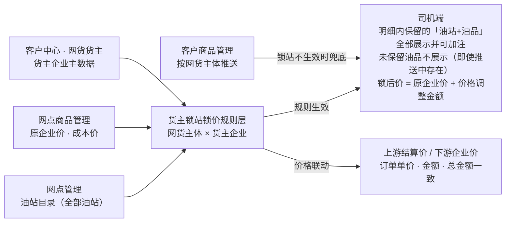
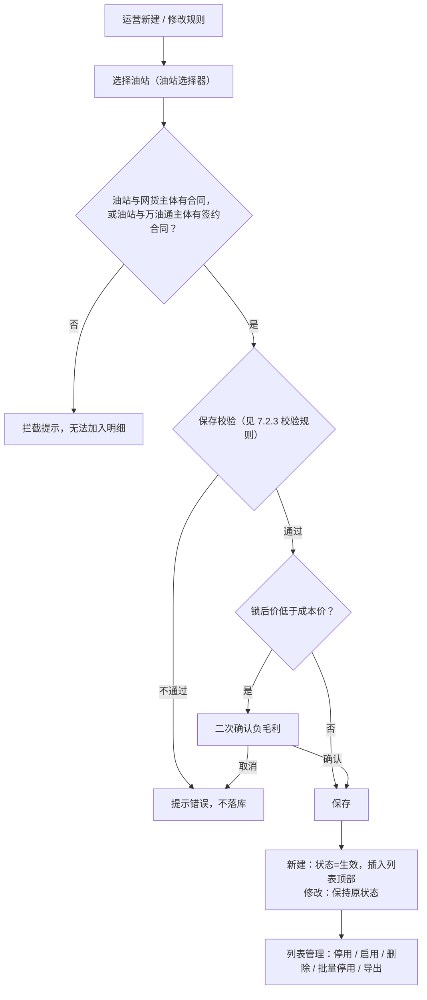
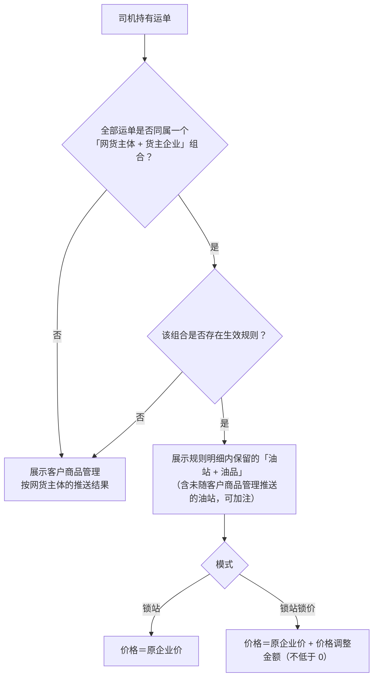

# 货主锁站锁价 · 产品需求

> 本文件为 PRD 本地定稿，与飞书文档《货主锁站锁价》正文同源；写入飞书时去掉本行以上的标题与引语。

## 5. 需求概述

本模块包含两个运营平台页面：**客户中心「网货货主」**维护货主企业主数据（列表、导入、导出、业务负责人、查看主体订单；页面为现网已有，本次仅新增导入功能）；**商品中心「货主锁站锁价」**按「网货主体 × 货主企业」维度配置规则，确定司机端可见的油站与价格。两种模式：**锁站**（不调价，价格沿用原企业价）与**锁站锁价**（逐行填写价格调整金额：正数=涨价、负数=降价）。规则生效期间，明细内保留的「油站+油品」全部展示并可加注——规则涉及的油站仅展示保留的油品行（某油站只保留部分油品时，未保留的油品不展示，即使客户商品管理推送中存在），规则未涉及的推送油站照常展示；可选油站为网点管理全部油站，未随客户商品管理推送的油站同样可见；锁站不生效时，回落客户商品管理按网货主体的推送数据。锁后价同步驱动上游结算价与下游企业价，锁价生效期间生成的订单，上下游单价、金额、总金额同步变动且保持一致。

术语（全篇统一）：**网货主体**＝现网客户企业（系统主数据）；**货主企业**＝「客户中心 → 网货货主」页面维护的主数据（货主ID 系统生成、支持页面导入；锁站规则的选择器取自该主数据）；**原企业价**＝「网点商品管理」维护的「油站 × 油品」价格（即调价前的企业价，本模块的价格基准）；**客户商品管理推送**＝客户商品管理按网货主体维度展示的油站推送数据（锁站不生效时的兜底数据源）；**价格调整金额**＝在原企业价基础上调整的金额，单位元（正数=涨价、负数=降价）；**锁后价**＝原企业价 + 价格调整金额（正加负减）。

### 5.1 需求范围

- 覆盖端与页面：运营平台「网货货主」页（`#oilWangHuoCustomerInfo`，现网已有页面，本次仅新增导入功能）；运营平台「货主锁站锁价」页（`#freightLock`），含列表页与同页三个浮层视图：新建/修改货主锁站规则抽屉、锁站规则详情抽屉、选择油站弹层。
- 司机端不在本模块页面范围内，仅承载生效口径（见 6.2 产品流程）。
- 明确不做：「只改价、不缩范围」的独立模式（由锁站锁价模式对保持可见的行填价格调整金额 0 实现）；规则适用范围之外的主体/货主的可见性调整（规则只作用于其适用范围）。

## 6. 需求详述

### 6.1 应用架构

架构图：

架构说明：本模块新建的主数据只有规则本身。网货主体取自现网客户企业主数据（搜索下拉引用）；货主企业取自「客户中心 → 网货货主」维护的主数据；油站目录取自网点管理全部油站；原企业价、成本价在「网点商品管理」维护（与客户商品管理的按主体推送相互独立）。规则层输出「可见油站集合＋锁后价」：规则生效期间明细内保留的「油站+油品」全部可见可加注（规则涉及的油站未保留的油品不展示，即使推送中存在；规则未涉及的推送油站照常展示），锁站不生效时回落客户商品管理按网货主体的推送数据；锁后价同时驱动上游结算价与下游企业价的同步变更。

### 6.2 产品流程

产品流程图（配置侧）：

产品流程图（司机端判定）：

流程说明：

1. 判定前提是**组合一致性**：先判断司机的全部运单是否同属一个「网货主体+货主企业」组合——只要存在不同组合的运单，就不应用锁站锁价，直接展示客户商品管理按网货主体的推送结果；全部运单同属一个组合时，再判断该组合是否存在生效规则（「货主锁站锁价」模块的生效规则，锁站/锁站锁价任一模式），有则展示规则明细内保留的「油站+油品」并按模式取价，没有则展示客户商品管理推送结果。
2. **可见性模型**：规则生效期间，展示规则明细内保留的「油站+油品」并可加注——规则涉及的油站仅展示保留的油品行，该站未保留的油品不展示（即使客户商品管理按网货主体的推送中存在）；规则未涉及的推送油站照常展示；可选油站为网点管理全部油站，未随客户商品管理推送的油站（客户商品管理按网货主体推送中没有该油站）只要被「网货主体+货主企业」的生效规则配置，同样展示并可加注；锁站不生效（无生效规则 / 停用 / 删除）时回落客户商品管理按网货主体的推送数据。停用/删除规则后，下次查询即回落，已产生订单不追溯。
3. **合同校验**：添加油站时校验「油站与网货主体有合同，或油站与万油通主体有签约合同」，无合同的油站拦截、不可加入明细；订单生成时后端做同样校验，两者共同保证无合同油站不产生订单。
4. **价格联动**：价格调整金额同步驱动上游结算价与下游企业价；锁价生效期间生成的订单，上下游的单价、金额、总金额同步变动且保持一致（具体计算沿用现网结算逻辑，测试环节专项验证，见 8）。
5. 适用货主企业从主数据搜索选择，必选、至少选择一家（新建与编辑保存时均校验）——「不选＝全部货主企业」的场景由客户商品管理按网货主体的推送覆盖，不通过规则表达；已选货主无「生效/未生效」状态，每选一家都进入适用范围，可逐个移除。
6. 锁后价不低于 0，低于成本价走负毛利二次确认（与现网「允许负毛利推送」口径一致）。

## 7. 功能详情

### 7.1 功能清单

运营平台 · 客户中心：

| 一级模块 | 二级模块 | 功能点 | 类型 | 说明 |
|---|---|---|---|---|
| 客户中心 | 网货货主 | 货主导入 | 新增 | 网货货主页为现网已有页面（列表/导出/业务负责人/主体订单为既有能力，不列入本清单），本次仅新增同步导入：模板固定三列「货主ID / 货主名称 / 业务负责人(选填)」，逐行校验、失败行提示原因、合法行入库 |

运营平台 · 商品中心：

| 一级模块 | 二级模块 | 功能点 | 类型 | 说明 |
|---|---|---|---|---|
| 商品中心 | 货主锁站锁价 | 规则列表与筛选 | 更新 | 适用网货主体 / 适用货主企业 / 适用油站三列只保留数字；其余不变（8 列列表、6 项筛选、分页 20/50/100、列设置） |
| 商品中心 | 货主锁站锁价 | 新建/修改规则抽屉 | 更新 | 价格调整金额支持正负（正数=涨价、负数=降价，涨价不设上限）；适用货主企业改为搜索选择（下线粘贴清单 / Excel 上传录入方式）并设为必选（至少 1 家） |
| 商品中心 | 货主锁站锁价 | 货主企业搜索选择 | 更新 | 选项来自「客户中心 → 网货货主」主数据，平铺全部搜索（不随主体联动）、名称或 ID 模糊匹配、逐个勾选与移除，必选（至少 1 家） |
| 商品中心 | 货主锁站锁价 | 油站选择器 | 更新 | 搜索 / 能源筛选 / 只看已选 / 分页不变；新增添加时合同校验，无合同油站拦截 |
| 商品中心 | 货主锁站锁价 | 规则详情 | 更新 | 页脚新增导出（1 个 Excel 文件 3 个 sheet）；指标「有减价行」调整为「有调整行」 |
| 商品中心 | 货主锁站锁价 | 规则操作 | 更新 | 下线复制规则；保留详情 / 修改 / 停用 / 启用（含冲突拦截）/ 删除 / 批量停用 / 列表导出 |
| 商品中心 | 货主锁站锁价 | 司机端生效口径 | 更新 | 组合一致性判定不变；规则生效期间按明细保留的「油站+油品」展示并可加注（规则涉及的油站未保留的油品不展示，即使推送中存在；含未随客户商品管理推送的油站；规则未涉及的推送油站照常展示），不生效回落客户商品管理推送（页外口径，见 6.2） |
| 商品中心 | 货主锁站锁价 | 价格联动 | 新增 | 锁后价同步上游结算价与下游企业价，订单单价 / 金额 / 总金额一致（口径级，见 6.2 流程说明 4） |

### 7.2 功能说明

#### 7.2.1 网货货主（#oilWangHuoCustomerInfo）

菜单入口：网货货主

本页为**现网已有页面**（列表、筛选、导出、修改业务负责人、查看主体订单均为既有能力），本次仅**新增「导入」功能**；以下为页面全貌，供理解货主企业主数据结构及其与锁站规则选择器的衔接。

##### 说明

1. 页头：页面标题「网货货主」；右侧常驻动作区（导入、导出，其中**导入为本次新增**）。页面最下方提供可折叠的「页面说明」参考条（评审辅助，非页面功能元素）。
2. 筛选——货主ID：文本输入框；默认空；单值；手工输入；按货主ID包含匹配（不区分大小写）。
3. 筛选——货主名称：文本输入框；默认空；单值；手工输入；按货主名称包含匹配。
4. 重置：清空全部筛选条件并重绘列表。
5. 搜索：按当前条件过滤并重绘列表。
6. 列表列——序号：当前页内从 1 连续编号（第 2 页从 11 起编，随每页条数联动）。
7. 列表列——货主ID：系统生成的唯一标识（演示数据形如 `SH0200001`），等宽字体展示。
8. 列表列——货主名称：仅显示名称一行。
9. 列表列——下单次数：整数，右对齐；系统按订单统计，不可手工修改。
10. 列表列——累计实付：金额，右对齐，「¥」＋两位小数；系统统计，不可手工修改。
11. 列表列——最近下单时间：`yyyy-MM-dd HH:mm:ss`（秒级）；无订单显示 `----`。
12. 列表列——业务负责人：可点击（悬浮虚线下划线提示「点击修改业务负责人」）；为空显示 `----`。
13. 列表列——创建时间：`yyyy-MM-dd HH:mm:ss`（秒级）。
14. 列表列——操作：「查看主体订单」，操作列冻结在右侧。
15. 分页：10/20/30/50/100/200/500 条每页（默认 10）；「共 N 条 · M 页」＋页码。
16. 列表为空：显示「暂无符合条件的网货货主」。
17. 页头动作——导入：打开「导入货主」弹层（见操作与状态）。
18. 导入弹层：标题「导入货主」；文件选择框（支持 .xlsx/.xls/.csv）＋提示「表头固定三列：**货主ID**、**货主名称**、**业务负责人**（选填），不依赖列顺序」；选择文件后展示校验结果表（列：货主ID / 货主名称 / 业务负责人 / 校验结果，失败行标红显示「失败：<原因>」），同时页脚出现「确认导入」按钮；页脚「取消 / 确认导入」。
19. 导入校验口径：货主ID 与货主名称必填，缺失计入失败；货主ID 与已有数据或本批内重复计入失败；合法行入库——新增货主下单次数 0、累计实付 ¥0.00、最近下单时间 `----`、业务负责人取文件值（空为空）、创建时间＝当前时间，插入列表顶部；导入完成提示「导入完成：成功 N 条，失败 M 条（详见校验结果）」。
20. 页头动作——导出：按当前筛选条件提交导出任务，提示「已按当前筛选条件提交导出任务，请在下载中心查看」。
21. 修改业务负责人：点击负责人单元格打开「修改业务负责人」弹窗；正文展示货主名称＋ID；输入框 ≤20 字，占位「请输入业务负责人姓名，留空表示清除」；「确认保存」更新并提示「业务负责人已更新」；留空保存＝清除（列表显示 `----`）。
22. 查看主体订单：行操作打开「查看主体订单」弹窗；正文首行展示货主名称＋ID；表格 6 列【订单流水号、运单号、公司信息、司机信息、油站信息、支付状态】；无订单显示「暂无数据」；页脚「关闭」。
23. 数据衔接：本页主数据即 7.2.3「适用货主企业」选择器的选项来源；本页导入新增的货主即时出现在选择器可选列表。

##### 操作与状态

| 操作 | 什么状态展示 | 什么状态可操作 | 操作结果 |
|---|---|---|---|
| 导入 | 页头常驻 | 任何状态可用 | 打开导入弹层；选择文件→展示校验结果→「确认导入」入库并提示成功/失败条数 |
| 确认导入 | 选择文件且解析出结果后显示 | 校验结果已展示 | 合法行写入主数据并插入列表顶部，弹层关闭，提示「导入完成：成功 N 条，失败 M 条（详见校验结果）」 |
| 导出 | 页头常驻 | 任何状态可用 | 按当前筛选提交下载中心任务并提示 |
| 修改业务负责人 | 点击负责人单元格触发 | 任何状态可用 | 弹窗保存后更新负责人；留空＝清除（显示 `----`） |
| 查看主体订单 | 每行常驻 | 任何状态可用 | 打开弹窗展示该货主主体订单；无订单显示「暂无数据」 |
| 重置 / 搜索 | 筛选区常驻 | 任何状态可用 | 清空条件 / 按条件过滤并重绘列表 |

##### 枚举值与口径

| 字段/状态 | 全部取值（穷举） | 出处（原型位置） |
|---|---|---|
| 主体订单支付状态 | 已支付、待支付、已退款 | 查看主体订单弹窗「支付状态」列 |
| 分页 | 10、20、30、50、100、200、500 条/页 | 列表分页器 |
| 负责人空值展示 | `----` | 业务负责人列、弹窗回显 |
| 无订单展示 | 最近下单时间列与主体订单弹窗均为 `----` / 「暂无数据」 | 最近下单时间列、查看主体订单弹窗 |

##### 校验规则（如有）

| # | 触发条件 | 规则 | 提示文案 | 是否阻断 |
|---|---|---|---|---|
| 1 | 导入行货主ID 或货主名称缺失 | 该行计入失败 | 校验结果行标红「失败：<原因>」；完成提示「导入完成：成功 N 条，失败 M 条（详见校验结果）」 | 该行不入库，其余行正常 |
| 2 | 导入行货主ID 与已有数据重复 | 该行计入失败 | 同上 | 该行不入库 |
| 3 | 导入行货主ID 与本批内重复 | 该行计入失败 | 同上 | 该行不入库 |
| 4 | 负责人输入超过 20 字 | 输入框限制长度 | 输入框 maxlength 截断 | 阻断输入 |

#### 7.2.2 货主锁站锁价 · 列表页（#freightLock）

菜单入口：货主锁站锁价

##### 说明

1. 页头：页面标题「货主锁站规则」；右侧常驻动作区（新建规则、批量停用、导出、列设置）；不展示规则总数计数。页面最下方提供可折叠的「规则说明与设计口径」参考条（评审辅助，非页面功能元素）。
2. 筛选——规则名称：文本输入框；默认空；单值；手工输入；按规则名称包含匹配。
3. 筛选——规则状态：下拉；默认「全部」（空）；单选；选项【生效、停用】；精确相等。
4. 筛选——模式：下拉；默认「全部」（空）；单选；选项【锁站、锁站锁价】；精确相等。
5. 筛选——网货主体：下拉；默认「全部」（空）；单选；选项来自现网客户企业主数据（按名称展示）；命中口径＝规则的适用网货主体包含所选主体。
6. 筛选——货主企业：文本输入框；默认空；单值；手工输入；按货主企业名称包含匹配（不区分大小写）。
7. 筛选——更新时间：日期选择器（年月日，不含时分秒）；默认空；单值；日历选择；按「最近更新日期＝所选日期」单日相等匹配，不是区间。
8. 重置：清空全部筛选条件并重绘列表。
9. 搜索：按当前条件过滤并重绘列表。
10. 页头动作——新建规则：打开新建抽屉（见 7.2.3）。
11. 页头动作——批量停用：对勾选规则中「生效」的置为停用（原本已停用的不受影响，修改人与时间刷新）；未勾选任何行时提示「请先勾选需要处理的规则」；成功提示「已停用 N 条规则」；无二次确认。
12. 页头动作——导出：按当前筛选条件提交导出任务，提示「已按当前筛选条件提交导出任务，请在下载中心查看」。
13. 列设置：控制列表列显隐，按钮显示「已显示列数/总列数」。
14. 列表列——勾选列：行首复选框，全行可勾选；表头复选框全选本页；供批量停用使用。
15. 列表列——规则名称：仅显示规则名称一行（不展示备注摘要）。
16. 列表列——规则状态：标签【生效、停用】。
17. 列表列——模式：标签【锁站、锁站锁价】。
18. 列表列——适用网货主体：只显示「N 个」（右对齐数字）；主体名单在详情抽屉查看，按主体检索走筛选区。
19. 列表列——适用货主企业：只显示「N 个」（右对齐数字）；货主名单在详情抽屉查看，按货主检索走筛选区与详情清单搜索。
20. 列表列——适用油站：只显示「M 个」（右对齐数字，按明细行的油站去重计数）。
21. 列表列——最近更新：主行日期时间（精确到分），副行最近修改人。
22. 列表列——操作：详情 / 修改 / 停用或启用 / 删除，操作列冻结在右侧；列表不展示规则编号——编号只在详情抽屉与冲突提示中用于定位。
23. 分页：20/50/100 条每页（默认 20）；「共 N 条 · M 页」＋页码。
24. 列表为空：显示「暂无符合条件的锁站规则」。
25. 列表顺序：新建规则插入列表顶部；修改不改变位置。

##### 操作与状态

| 操作 | 什么状态展示 | 什么状态可操作 | 操作结果 |
|---|---|---|---|
| 新建规则 | 页头常驻 | 任何状态可用 | 打开新建抽屉 |
| 详情 | 每行常驻 | 任何状态可用 | 打开详情抽屉（见 7.2.4） |
| 修改 | 每行常驻 | 任何状态可用 | 打开修改抽屉并回显当前配置；保存后保持原状态 |
| 停用 | 仅「生效」行显示 | 生效状态；点击后二次确认 | 状态→停用；相关货主回落客户商品管理按网货主体的推送结果；该「主体+货主」组合可被新规则占用；已产生订单不追溯 |
| 启用 | 仅「停用」行显示 | 停用状态；点击后二次确认；确认时校验组合冲突 | 无冲突：状态→生效；冲突：拦截，提示「启用失败：适用范围与生效规则 <编号> 冲突：<主体> + <货主企业>」，状态不变 |
| 删除 | 每行常驻 | 任何状态；点击后二次确认（危险色） | 规则移除；相关货主回落客户商品管理按网货主体的推送结果；已下发配置不追溯 |
| 批量停用 | 页头常驻 | 需勾选 ≥1 行；无二次确认 | 勾选中生效的置停用，已停用不受影响 |
| 导出 | 页头常驻 | 任何状态可用 | 提交导出任务并提示 |

停用/启用/删除的二次确认弹窗：标题分别为「停用锁站规则 / 启用锁站规则 / 删除锁站规则」，正文展示规则名称与编号、当前状态、网货主体数、货主企业数；停用正文含「停用后相关货主不再受本规则限制，回落客户商品管理按网货主体的推送结果。」；停用按钮「确认停用」（危险色）、启用按钮「确认启用」、删除按钮「确认删除」（危险色）。

##### 枚举值与口径

| 字段/状态 | 全部取值（穷举） | 出处（原型位置） |
|---|---|---|
| 规则状态 | 生效、停用 | 状态列标签、规则状态筛选项、停用/启用确认弹窗 |
| 模式 | 锁站、锁站锁价 | 模式列标签、模式筛选项、抽屉二分段 |
| 分页 | 20、50、100 条/页 | 列表分页器 |
| 能源类型 | 取油站目录实际值（演示数据：柴油、天然气） | 抽屉明细/选择器能源筛选 |

##### 校验规则（如有）

| # | 触发条件 | 规则 | 提示文案 | 是否阻断 |
|---|---|---|---|---|
| 1 | 批量停用未勾选任何行 | 提示后不执行 | 「请先勾选需要处理的规则」 | 阻断 |
| 2 | 启用规则时与生效规则的「主体+货主」组合冲突（冲突判定口径同 7.2.3 校验 13） | 状态不变 | 「启用失败：适用范围与生效规则 <编号> 冲突：<主体> + <货主企业>」 | 阻断 |

#### 7.2.3 新建/修改货主锁站规则抽屉（#freightLock）

菜单入口：无（由 7.2.2 进入——页头「新建规则」打开新建；行内「修改」打开修改并回显当前配置）

##### 说明

1. 标题：「新建货主锁站规则」/「修改货主锁站规则 <规则编号>」；与运营平台其他页面一致的停靠式宽抽屉（页面左侧停靠展开，主体区独立滚动，页脚常驻）。
2. 页脚：新建为「取消 / 保存并启用」；修改为「取消 / 保存修改」。
3. 规则名称（必填）：文本框；≤ 50 字；占位「例如：万联上海 · 沈阳天津锁站锁价」；仅用于运营识别，不参与判定。
4. 模式（必填）：二分段单选【锁站（价格沿用原企业价）／锁站锁价（逐行调整价格）】；切换为锁站时清空全部明细行价格调整金额且调整列禁用，切回锁站锁价需逐行重填；一条规则只能一种模式——两种模式对「价格调整金额是否必填」的校验口径互斥，需要两种效果时拆成两条规则（落在不同的「主体+货主」组合上）。
5. 备注：多行文本；选填；≤ 200 字；展示在详情抽屉（列表不展示备注）。
6. 适用网货主体（必填，≥ 1 个）：搜索下拉多选；默认空；输入名称或编码过滤；选项来自现网客户企业主数据；已选项以 chip 展示、可单个移除；无匹配显示「无匹配的网货主体」。
7. 适用货主企业（必填，≥ 1 家）：搜索多选选择器，与「适用网货主体」同款交互；**平铺全部货主企业主数据、不随所选主体联动**；输入名称或 ID 过滤（包含匹配，不区分大小写）；选项来自「客户中心 → 网货货主」主数据（含导入新增的货主）；已选项以 chip 展示（名称）、可单个移除；无匹配显示「无匹配的货主企业」。语义：每选一家都进入适用范围、无「生效/未生效」状态、可逐个移除；至少选择一家方可保存（未选时保存校验拦截）。
8. 适用范围组合口径（贯穿保存校验）：适用范围＝适用网货主体 × 适用货主企业（已选货主），取笛卡尔积。数字例子：适用网货主体选 2 个（A、B）、适用货主企业选 3 个（甲、乙、丙）→ 适用范围共 6 个组合（A甲、A乙、A丙、B甲、B乙、B丙）。
9. 油站与油品明细（必填 ≥ 1 行；一行＝一个「油站+油品」；明细内油站仅能来自通过合同校验的油站，见 7.2.5）：
   1. 工具条：「选择油站」按钮、「清空明细」按钮、汇总「共 N 行 · 覆盖 M 个油站」（锁站锁价模式追加「· 有调整 K 行」，K＝价格调整金额 ≠ 0 的行数；有筛选时追加「· 当前筛选 X 行」）。
   2. 明细表列：油站编码／油站·油站公司／油品·能源／原企业价／成本价／价格调整金额／锁后价／操作（删除）。
   3. 明细区搜索：文本框；默认空；按油站名称/编码/油站公司/油品名包含匹配；输入与翻页只重绘列表区，搜索框不失焦。
   4. 明细区能源筛选：分段单选【全部能源＋已选油站出现的能源类型】。
   5. 只看有调整的行：开关按钮；仅锁站锁价模式显示，只显示价格调整金额 ≠ 0 的行。
   6. 价格调整金额：仅锁站锁价模式可填；数字输入框（唤起数字键盘），最多两位小数，逐行必填；**正数＝涨价、负数＝降价，涨价不设上限**；输入自动清洗——首个负号「-」允许（全角「－」归一为半角）、全角句号/逗号视为小数点、其余非法字符被过滤、仅保留一个小数点；新加入行留空并标红「必填」；填 0 表示可见但不调价；行内修改只重算该行锁后价与汇总（不做批量填写，行数多时用搜索与「只看有调整的行」缩小范围）。
   7. 锁后价：只读实时计算＝原企业价 + 价格调整金额（正加负减，按 0 截断显示）；低于成本价标红并悬浮提示「低于成本价，保存前需确认负毛利」。
   8. 原企业价／成本价：只读，来自「网点商品管理」维护的油站×油品价格；无企业价的行显示「无企业价」、调整列显示「—」不可填、不计入有效明细。
   9. 失效行：油站/油品已不在系统目录的行，表格顶部黄条「有 N 行的油站或油品已不在系统目录中（<前 3 行站/品> 等），请删除后重新选择，否则无法保存。」
   10. 唯一性：同一「油站+油品」在一条规则内不重复（选择器勾选即加入、取消即移出）。
   11. 空态：「尚未选择油站，点击『选择油站』从系统已有油站中添加；勾选油站即带出该站全部油品行，可在此逐行填写价格调整金额或删除不需要的油品」。
10. 油站选择器：见 7.2.5。
11. 关闭保护：抽屉内有未保存改动时，点 ✕、点遮罩、按 Esc 或点「取消」→ 二次确认弹窗「放弃未保存的改动」（正文「当前抽屉里有尚未保存的修改。」，按钮「放弃修改」）；确认后关闭且不保存；无改动直接关闭。判定基准＝打开抽屉时的配置快照（名称/模式/备注/适用范围/明细与价格调整金额）。
12. 保存后的状态：新建 → 状态＝生效，插入列表顶部，提示「规则已保存并启用」；修改 → 覆盖式更新且保持规则原有状态（停用规则保存后仍为停用，提示「规则已更新（保持停用状态）」；生效规则提示「规则已更新」），不会因保存而静默启用。

##### 操作与状态

| 操作 | 什么状态展示 | 什么状态可操作 | 操作结果 |
|---|---|---|---|
| 保存并启用 | 新建抽屉页脚常驻 | 校验全部通过（负毛利需二次确认） | 新建规则状态＝生效，插入列表顶部 |
| 保存修改 | 修改抽屉页脚常驻 | 校验全部通过（负毛利需二次确认） | 覆盖更新，保持原状态 |
| 取消 | 页脚常驻 | 任何状态；有未保存改动时二次确认 | 关闭抽屉，不保存 |
| 选择油站 | 明细工具条常驻 | 任何状态 | 打开油站选择器（见 7.2.5） |
| 清空明细 | 明细工具条常驻 | 已有明细行 | 清空全部明细行 |
| 删除（明细行） | 每行常驻 | 任何状态 | 移除该行并重算汇总 |
| 货主企业勾选/移除 | 选择器列表 / chip 常驻 | 任何状态 | 勾选加入适用范围、移除退出；全部移除后保存被拦截（校验 5） |

##### 枚举值与口径

| 字段/状态 | 全部取值（穷举） | 出处（原型位置） |
|---|---|---|
| 模式 | 锁站（价格沿用原企业价）、锁站锁价（逐行调整价格） | 基本信息二分段 |
| 价格调整金额符号 | 正数＝涨价、负数＝降价、0＝可见但不调价 | 明细列输入框悬浮提示、锁后价计算 |
| 适用货主企业必选 | 至少 1 家（新建与编辑保存时均校验） | 适用范围选择器、校验 5 |
| 分页 | 20、50、100 条/页（默认 20） | 明细/选择器/详情货主清单分页器 |
| 能源类型 | 取油站目录实际值（演示数据：柴油、天然气） | 明细能源筛选、选择器能源筛选 |
| 油品 | 来自网点商品管理维护的油站油品（演示数据：0# 轻柴油、-10# 柴油、-20# 柴油、LNG、CNG） | 明细行（选择器勾选油站后带出该站全部油品） |

##### 校验规则（如有）

| # | 触发条件 | 规则 | 提示文案 | 是否阻断 |
|---|---|---|---|---|
| 1 | 保存 | 规则名称为空 | 「请填写规则名称」（toast 前缀「保存失败：」） | 阻断 |
| 2 | 保存 | 规则名称超过 50 字 | 「规则名称不超过 50 个字」 | 阻断 |
| 3 | 保存 | 备注超过 200 字 | 「备注不超过 200 个字」 | 阻断 |
| 4 | 保存 | 未选网货主体 | 「请至少选择一个适用网货主体」 | 阻断 |
| 5 | 保存 | 未选适用货主企业 | 「请至少选择一个适用货主企业」 | 阻断 |
| 6 | 保存 | 油站明细为空 | 「请至少选择一个『油站 + 油品』」 | 阻断 |
| 7 | 保存 | 有明细行的油站/油品已不在系统目录 | 「有 N 行的油站或油品已不在系统目录中，请删除后重新选择」 | 阻断 |
| 8 | 保存 | 所选油站油品均无企业价 | 「所选油站油品均无企业价，无法配置」 | 阻断 |
| 9 | 保存 | 锁站锁价模式有行未填价格调整金额 | 「有 N 行未填写价格调整金额」；行内输入框同步标红 | 阻断 |
| 10 | 保存 | 价格调整金额超过两位小数 | 「有 N 行的价格调整金额超过两位小数」 | 阻断 |
| 11 | 保存 | 锁站锁价模式下全部行价格调整金额＝ 0 | 「锁站锁价模式下请至少为一行填写非 0 的价格调整金额（正数=涨价、负数=降价），否则请改用『锁站』模式」 | 阻断 |
| 12 | 保存 | 锁后价 < 0（价格调整金额为负数、且降幅大于原企业价） | 「有 N 行锁后价小于 0，请调高价格调整金额」 | 阻断 |
| 13 | 保存 | 本次适用范围（笛卡尔积逐组合）与任一生效规则组合相交；修改时排除规则自身；停用规则不参与；规则内自身重复一并提示 | 「适用范围与生效规则 <规则编号>（自身重复时为「（本规则内重复）」）冲突：<网货主体> + <货主企业>」；不落库 | 阻断 |
| 14 | 保存 | 锁后价 < 成本价 | 二次确认弹窗「确认负毛利推送」：「有 N 行的锁后价低于成本价。」，说明「负毛利推送需与现网『允许负毛利推送』开关口径一致。」「确认后规则保存并立即生效；已产生订单的价格不追溯。」，按钮「确认保存」 | 确认后放行 |

保存校验按 1→13 顺序执行，命中第一条即 toast「保存失败：<提示>」并停止（14 为确认后放行）。

#### 7.2.4 锁站规则详情抽屉（#freightLock）

菜单入口：无（由 7.2.2 进入——行内「详情」按钮）

##### 说明

1. 标题：「锁站规则详情」；页脚「导出 / 关闭 / 修改」。
2. 页头：规则编号（等宽字体）＋规则名称＋状态标签＋模式标签＋「N 行明细」标签；4 项指标：适用网货主体（N 个）／适用货主企业（N 个）／可见油站（M 个，按明细行油站去重）／有调整行（N 行，价格调整金额 ≠ 0 的行数）。
3. 基本信息：规则编号／规则状态／模式／创建（时间＋人）／最近修改（时间＋人）／备注（空显示「—」）；时间精确到分。
4. 适用网货主体：全量表，列【网货主体名称、网货主体ID】。
5. 适用货主企业：≤ 20 个直接铺「名称＋ID」表（引导语「共 N 个货主企业」）；> 20 个启用「名称/ID 搜索（包含匹配）＋分页（20/50/100，默认 20）」，只渲染当前页，检索与翻页只重绘清单区、输入框不失焦，表尾常驻「当前筛选 X / 共 N 个货主企业」。数字例子：500 个货主 → 默认首页 20 行，搜索「天津」后表尾显示「当前筛选 X / 共 500 个」。
6. 油站与油品明细：全量逐行表（油站编码／油站·油站公司／油品／原企业价／成本价／价格调整金额／锁后价），不做分页与检索；价格调整金额列锁站模式显示「—」、锁站锁价模式正数显示「+金额」（涨价）、负数显示「-金额」（降价）、0 显示「0.00」；锁后价低于成本价标红。
7. 导出：页脚「导出」导出本规则全量名单（不受抽屉内搜索与翻页影响，不限规则状态）；导出为 1 个 Excel 文件、3 个 sheet，文件名「规则编号_规则名称.xlsx」（如 `AS2026100001_万联上海 · 沈阳天津锁站锁价.xlsx`）；导出后提示「已导出『<文件名>』（3 个 sheet：适用网货主体 N 行 · 适用货主企业 X 个 · 油站油品明细 M 行）」。sheet 结构：
   1. Sheet1 适用网货主体：一行＝一个主体，列【网货主体名称、网货主体ID】。
   2. Sheet2 适用货主企业：一行＝一个货主，列【货主企业名称、货主企业ID】。
   3. Sheet3 油站油品明细：一行＝一条明细，列【油站编码、油站名称、油站公司、油品、原企业价、成本价、价格调整金额、锁后价】（锁站模式价格调整金额列＝「—」、锁后价＝原企业价；价格调整金额列按原始带符号值输出，正数不加「+」、负数带「-」）。

##### 操作与状态

| 操作 | 什么状态展示 | 什么状态可操作 | 操作结果 |
|---|---|---|---|
| 导出 | 页脚常驻 | 任何状态 | 提示已导出及 3 个 sheet 行数（原型不落真实文件） |
| 关闭 | 页脚常驻 | 任何状态 | 关闭详情抽屉 |
| 修改 | 页脚常驻 | 任何状态 | 关闭详情并打开修改抽屉（回显当前配置） |

#### 7.2.5 选择油站弹层（#freightLock）

菜单入口：无（由 7.2.3 明细区「选择油站」按钮打开）

##### 说明

1. 标题：「选择油站」；页脚「完成」。**以油站为选择粒度**——弹层内只展示与勾选油站，不展示油品勾选；勾选油站即带出该站全部油品行进入 7.2.3 明细，需要精修时在明细区删行或逐行填价格调整金额。
2. 打开即重置：每次打开弹层，搜索词、能源筛选、「只看已选」、页码与每页条数全部回到默认（不保留上次会话的筛选状态）。
3. 搜索：文本框；默认空；按油站名称/编码/油站公司/城市包含匹配；不含油品名——油品检索在 7.2.3 明细区搜索完成。
4. 能源筛选：分段单选【全部能源＋油站目录实际能源类型（演示数据：柴油、天然气）】。
5. 只看已选：开关按钮，仅显示已勾选的油站。
6. 清空已选：一键清空全部已选明细。
7. 计数：工具条常驻「已选 M 个油站」（按明细行油站去重）。
8. 油站行：一行一站——勾选框＋油站名称＋「油站公司 · 能源 · 城市」＋油站编码；已勾选的站整行高亮并显示「已选择」标识；勾选＝该站全部油品行进明细（价格调整金额留空待逐行填写）、取消＝移出该站全部明细行。
9. **合同校验（添加油站时）**：勾选油站加入明细时校验「油站与网货主体有合同，或油站与万油通主体有签约合同」；无合同的油站拦截、不进入已选与明细，提示「添加失败：该油站与网货主体及万油通主体均无签约合同，无法添加」（演示数据 `ST0009` 锦州凌海物流站为无合同油站，用于演示拦截）；有合同的油站不受影响。订单生成时后端做同样校验。
10. 分页：20/50/100 条每页（默认 20）；翻页与筛选只重绘列表区，搜索框不失焦。
11. 空态（按原因区分三种）：开启「只看已选」且尚无已选时「还没有已选的油站：在下方勾选油站后，可在此查看已勾选的油站」；开启「只看已选」但已选油站与当前搜索/能源筛选无交集时「已勾选的油站不在当前搜索与能源范围内」；默认「没有符合当前筛选的油站」。

##### 操作与状态

| 操作 | 什么状态展示 | 什么状态可操作 | 操作结果 |
|---|---|---|---|
| 完成 | 页脚常驻 | 任何状态 | 关闭弹层，已勾选内容保留在明细 |
| 油站勾选/取消 | 每行常驻 | 有合同油站可勾选；无合同油站勾选即拦截 | 勾选带出该站全部油品行 / 取消移出该站全部明细行，并联动计数；无合同油站提示「添加失败：该油站与网货主体及万油通主体均无签约合同，无法添加」且不入已选 |

### 7.3 数据定义

| 字段 | 说明与口径 |
|---|---|
| 货主ID | 系统生成的唯一标识（演示数据形如 `SH0200001`）；导入时作为查重键（与已有数据或本批内重复即失败） |
| 货主名称 | 网货货主主数据名称 |
| 业务负责人 | 文本 ≤ 20 字，选填；空显示 `----`；点击列表单元格可修改 |
| 下单次数 / 累计实付 / 最近下单时间 | 系统按订单自动统计，不可手工修改；最近下单时间秒级（`yyyy-MM-dd HH:mm:ss`），无订单 `----` |
| 货主创建时间 | 秒级（`yyyy-MM-dd HH:mm:ss`）；导入新增＝导入时刻 |
| 规则编号 | 系统生成，「AS」前缀（演示数据形如 AS2026100001）；不作为列表列与筛选项，仅在详情抽屉与冲突提示中用于定位 |
| 规则名称 | 文本，≤ 50 字，必填；仅用于运营识别 |
| 模式 | 锁站 / 锁站锁价 |
| 规则状态 | 生效 / 停用 |
| 备注 | 文本，≤ 200 字，选填 |
| 适用网货主体 | 现网客户企业 ID 列表，≥ 1 个 |
| 适用货主企业 | 货主主数据 ID 列表（选择器勾选，每一家都进入适用范围，无生效/未生效状态）；必填，≥ 1 家 |
| 明细行 | 「油站编码＋油品」组合，同规则内不重复；价格调整金额仅锁站锁价模式有值，正数=涨价、负数=降价、最多两位小数 |
| 锁后价 | 原企业价 + 价格调整金额（正加负减），不得小于 0 |
| 创建 / 最近修改 | 人＋时间；时间精确到分 |

### 7.4 数据架构

无

### 7.5 数据埋点

无

### 7.6 历史数据处理

无（本模块为新增功能，无存量数据迁移）

### 7.7 非功能需求

无

### 7.8 性能需求

1. 量级假设：油站目录 ≤ 300 个（展开 ≤ 约 600 行明细）、货主主数据 ≤ 500 个（演示数据 520 个）、单规则适用货主企业 ≤ 500 个。
2. 货主企业搜索选择器一次加载全部主数据、前端过滤（名称/ID 包含匹配）；油站与油品明细、油站选择器统一走「搜索＋筛选＋分页」，分页 20/50/100 条每页（默认 20）。
3. 检索与翻页只重绘列表区，不重绘整个抽屉（输入框不失焦）。
4. 前端分页实现；接口按后端分页预留（page/pageSize 参数），数据量继续增长时无需改页面结构。

## 8. 测试重点

1. 唯一性：保存与启用两个时机均校验「主体×货主」组合冲突；修改排除规则自身；停用规则不参与；冲突提示包含冲突规则编号。
2. 司机端可见性与判定：先判断全部运单是否同属一个「网货主体+货主企业」组合，存在不同组合即展示客户商品管理推送数据、不应用规则；同组合且有生效规则时，展示规则明细内保留的「油站+油品」并可加注——规则涉及的油站仅展示保留行、未保留的油品不展示（即使推送中存在），**含未随客户商品管理推送的油站**（推送中无该油站、规则有配置→可见可加注），规则未涉及的推送油站照常展示；锁站不调价、锁站锁价按价格调整金额取价（不低于 0）；无生效规则与停用/删除后回落客户商品管理按网货主体的推送数据；已产生订单不追溯。
3. 价格联动（专项）：锁后价同步驱动上游结算价与下游企业价；锁价生效期间生成的订单，上下游订单单价、金额、总金额同步变动且保持一致；联动失败场景需暴露并可定位。
4. 未推送油站可见与加注（专项，呼应第 2 条）：配置侧——油站选择器选项来自「网点管理」全部油站，未被客户商品管理推送的油站同样可搜索、可勾选进规则明细（通过合同校验的前提下）；司机端——某「网货主体+货主企业」组合的生效规则明细内含油站 X，而客户商品管理按该网货主体的推送数据中不含 X：该组合下 X 正常展示、可加注（锁站模式按原企业价取价、锁站锁价按锁后价＝原企业价+价格调整金额，价格调整金额 0＝按原企业价），加注订单正常计价；反面断言——该组合无生效规则（或停用/删除）时，未被推送的 X 不展示；可见范围＝（客户商品管理推送中规则未涉及的油站）∪（生效规则明细保留的「油站+油品」行），规则涉及的油站未保留的油品不展示，不做放宽；数据准备：选一个「网点管理有、客户商品管理推送无」的油站配置进该组合的规则明细。

## 9. 依赖与风险

1. 依赖「网点商品管理」：原企业价、成本价（锁后价基准与负毛利判定）只读引用；价格在该页面维护、与客户商品管理的按主体推送相互独立。
2. 依赖「网点管理」：油站目录（规则可选范围＝网点管理全部油站）。
3. 依赖「客户中心 → 网货货主」：货主企业主数据（选择器选项来源、司机端组合判定依据）。
4. 依赖「客户商品管理」按网货主体的推送：锁站不生效时的兜底数据源。
5. 依赖合同与万油通主体签约数据：添加油站时的合同校验与订单生成校验的数据来源。
6. 依赖下载中心：列表导出与详情导出任务的文件产出与提醒。
7. 风险——价格联动一致性：锁后价需同步上游结算价与下游企业价，若任一侧未同步改造，存在上下游订单单价/金额/总金额不一致的风险；测试环节按 8.3 专项验证，联调阶段需覆盖涨价（正调整金额）与降价两类样本。
8. 风险——负毛利管控：本模块二次确认口径需与现网「允许负毛利推送」开关保持一致，避免两侧管控不一致。
